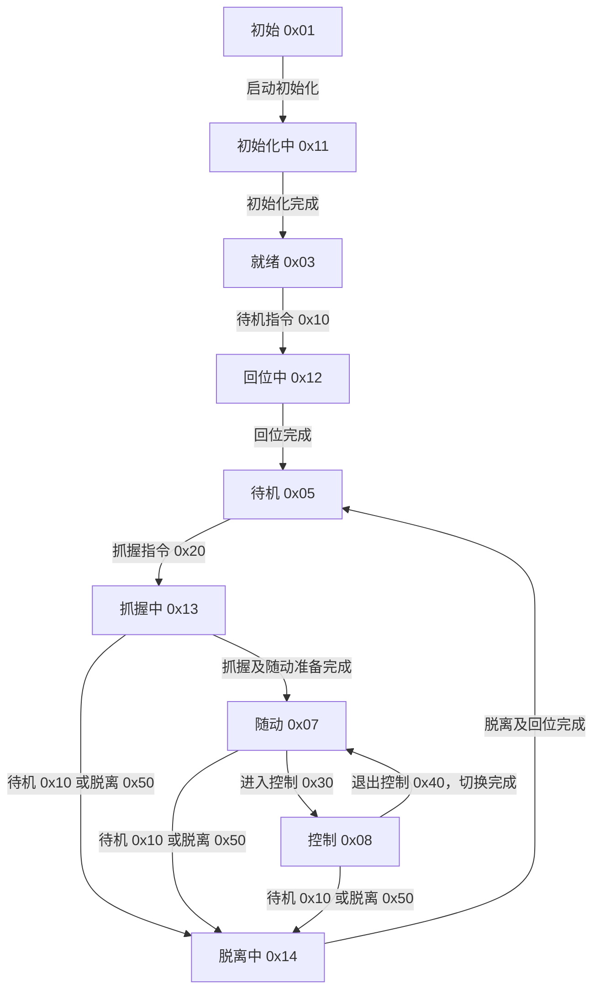

# AVIATOR RS422 状态切换使用说明

使用者通过下行状态指令发起操作，通过上行运行状态确认进度和完成结果。以下数值均为 RS422 报文中的十六进制值。

下行“状态切换指令”位于偏移 3；上行“状态指令回绕”位于偏移 5，“运行状态”位于偏移 10。偏移从 0 开始。**指令回绕不代表切换已完成，应以上行运行状态确认操作结果。**

## 1. 上行状态含义

| 运行状态 | 名称 | 使用者看到的含义 |
| --- | --- | --- |
| `0x01` | 初始 INIT | 已启动，等待开始初始化。 |
| `0x11` | 初始化中 INITIALIZING | 正在完成初始化和使能。 |
| `0x03` | 就绪 READY | 初始化完成，尚未进入待机位。 |
| `0x12` | 回位中 HOMING | 正在回到待机位。 |
| `0x05` | 待机 STANDBY | 已完成回位，可以请求抓握驾驶盘。 |
| `0x13` | 抓握中 GRASPING | 正在接近、抓握驾驶盘，并准备进入随动。 |
| `0x07` | 随动 FOLLOWING | 已抓握驾驶盘，处于随动模式，尚未进入飞控控制。 |
| `0x08` | 控制 CONTROL | 已进入飞控控制；退出控制的切换过程中仍显示此状态，完成后显示随动。 |
| `0x14` | 脱离中 RELEASING | 正在执行松手、撤离和回位流程；完成后进入待机。 |
| `0x10` | 故障 ERROR | 当前操作中断，需要处理故障并执行复位。 |
| `0xFF` | 急停 EMERGENCY_STOP | 已进入急停，普通状态指令不能退出。 |

启动等待期间还可能显示 `0xFE`（未启动）。当前网关在没有可用运行状态时也会发送此值，因此不能据此判断机器人具体动作；它不属于上述动作切换流程。

## 2. 正常切换流程

图中为常用流程。初始化期间提前请求待机、故障复位等情况见下表。

## 3. 下行指令与切换条件

| 下行指令 | 适用状态和条件 | 状态变化 |
| --- | --- | --- |
| `0x00` 无操作 | 任意状态 | 不发起新的切换，也不取消正在执行的动作。 |
| `0x10` 待机 | 除故障、急停外的状态；设备具备执行条件 | 按第 4 节回待机。 |
| `0x20` 抓握驾驶盘 | 待机，设备就绪且前序动作已结束 | 待机 → 抓握中 → 随动。 |
| `0x30` 进入控制 | 随动，前序动作已结束，飞控输入已就绪 | 随动 → 控制。 |
| `0x40` 退出控制 | 控制，前序动作已结束 | 控制 → 随动；保持抓握，不回待机位。在随动状态发送则保持随动。 |
| `0x50` 脱离驾驶盘 | 除故障、急停外的状态；设备具备执行条件 | 与 `0x10` 相同，按第 4 节回待机。 |
| `0x60` 故障复位 | 故障原因已消除，设备就绪、动作已停止且具备恢复条件 | 故障 → 脱离中 → 待机。 |

未满足表中状态或条件时，指令不会启动对应切换。例如，就绪状态不能直接抓握，应先进入待机；待机状态不能直接进入控制，应先抓握并进入随动。

## 4. 待机和脱离指令如何执行

当前实现中，`0x10` 和 `0x50` 的最终目标均为**待机**，具体过程取决于当前状态。

| 当前状态 | 收到待机或脱离指令后的过程 |
| --- | --- |
| 初始 | 开始初始化 → 初始化中 → 回位中 → 待机。 |
| 初始化中 | 继续初始化，完成后直接进入回位中 → 待机，不停留在就绪。 |
| 就绪 | 通常进入回位中 → 待机；若需要先执行脱离流程，则进入脱离中 → 待机。 |
| 抓握中、随动、控制 | 转入脱离中，按当前抓握情况松手、撤离并回位，完成后进入待机。 |
| 回位中、脱离中 | 继续当前流程，完成后进入待机。 |
| 待机 | 保持待机。 |
| 故障、急停 | 不能通过这两个指令回待机。 |

脱离流程中的回位仍显示“脱离中”，不会再单独显示“回位中”。

## 5. 故障与急停后的切换

**故障：**正常运行过程中发生导致操作中断的故障，进入 `ERROR（0x10）`。故障原因消除后，发送 `0x60` 复位；满足恢复条件时进入 `RELEASING（0x14）`，完成必要的松手和回位后进入 `STANDBY（0x05）`。复位不会直接恢复随动或控制，需要重新抓握、再进入控制。恢复失败时回到故障状态。

**急停：**应急手刹触发（光电 X1＝0）等急停事件使系统进入 `EMERGENCY_STOP（0xFF）`。手刹恢复未触发（X1＝1）后，状态不会自动退出急停，`0x60` 也不能复位急停。解除急停原因后，需要重新启动机器人控制程序，从初始化流程重新开始。

## 6. 常用操作顺序

1. 启动后等待“就绪”。
2. 发送 `0x10` 待机，等待“待机”。
3. 发送 `0x20` 抓握，等待“随动”。
4. 发送 `0x30` 进入控制，确认“控制”。
5. 需要保持抓握并退出控制时，发送 `0x40`，等待“随动”。
6. 需要松手回位时，发送 `0x50` 或 `0x10`，等待“待机”。
