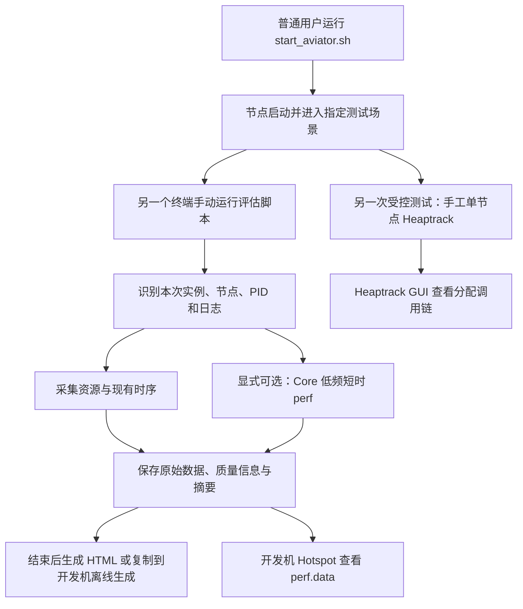

# AVIATOR 多进程性能评估与可视化方案

更新日期：2026-11-13；部署机环境核验时间：18:14（Asia/Shanghai）。

状态：基础评估、可选 CPU 采样和离线 HTML 已实现并部署，当前源码与部署机评估器版本 **1.2.2**（离线函数分析与实时内核收尾等待修正）。
本文以 `rocos@192.168.31.100` 的实际环境及已部署脚本为准；Heaptrack 自动化、off-CPU 自动化和基线比较另列为后续工作。

工具操作速查：[独立评估工具 README](../tools/evaluate/README.md)。

适用入口：[scripts/start_aviator.sh](../scripts/start_aviator.sh)

## 1. 目标与结论

在正常启动 AVIATOR 后，用户从另一个终端手动运行独立评估脚本，采集本次运行各节点的资源和控制时序数据，结束后生成可离线查看的 HTML 报告。默认每 2 秒采集资源，不启动 perf、Heaptrack 或 GUI。需要深入分析时，另行启用短时、单节点 perf，或在专项测试中手工使用 Heaptrack。

推荐工具组合：

| 层次 | 工具或数据来源 | 回答的问题 |
| --- | --- | --- |
| 系统与进程概况 | `/proc`、系统资源计数器 | 哪个节点占用资源？何时增长？是否有整机竞争？ |
| 控制时序 | 现有 `Motion timing`、`Servo timing` 日志 | 规划、回调和输入新鲜度是否出现异常？ |
| CPU 热点 | perf + Hotspot | CPU 消耗集中在哪些线程、函数和调用链？ |
| 等待分析，尚未自动化 | perf 调度事件 + Hotspot off-CPU | 时间是否耗在锁、I/O、睡眠或被调度出去？ |
| 堆内存分配，手工专项 | Heaptrack | 谁在频繁分配？峰值来自哪里？哪些分配持续存活？ |
| 跨进程业务延迟，后续扩展 | 业务事件、统一时钟语义、Perfetto | 输入经过各节点后，何时真正被消费？ |

多进程不是使用这些工具的障碍。各节点在同一负载下同时运行，perf 可以联合采集多个 PID；Heaptrack 按目标节点单独分析；统一报告通过同一采集时间轴展示节点间的资源变化。

性能评估分成两个任务：

1. **定位瓶颈**：允许受控的分析开销，找出值得优化的代码和等待路径。
2. **验证正常运行表现**：使用低开销观测，比较优化前后的资源、周期和延迟。

不得把 Heaptrack 或高开销追踪期间的延迟直接当作正常运行的实时性验收结果。有限测试中的最大观测值，也不等于最坏执行时间保证。

## 2. 当前项目基础与约束

### 2.1 启动结构

`start_aviator.sh` 的 `start()` 函数通过 `setsid` 启动节点，维护启动 PID、节点名称和退出清理逻辑。实际节点受启动参数和配置影响：

| 节点名称 | 程序或入口 | 启动条件及评估重点 |
| --- | --- | --- |
| `bus` | `aviator_bus` | 消息转发 CPU、上下文切换 |
| `photoelectric` | `aviator_photoelectric` | 真机模式；进程存活、资源和输入相关日志 |
| `manipulator` | `manipulator` | 真机模式，经 sudo 启动；规划与双臂 SDK 回调 |
| `simulation` | `simulation` | 仿真模式替代设备节点；仿真计算与共享控制逻辑 |
| `hand` | 专用 Python + 手节点启动器 | 真机模式；Python 和可能的后代进程 |
| `gateway` | `flight_gateway` | 输入接收、处理与发布 |
| `camera` | 专用 Python + `nodes/camera/main.py` | 由真机配置或 RS422 模式决定；视觉计算、原生库与缓冲 |
| `core` | `aviator_core_managed` | 状态机、业务动作、规划及通信 |
| `monitor` | `aviator_monitor` | HTTP 服务、资源查询和监控开销 |
| `logger` | `aviator_logger` | `--logger` 启用；编码、队列、写盘和内存 |
| `tts` | `aviator_tts` | `--tts` 启用；可选语音负载 |
| `wheel_test_ui` | Python 测试 UI | `--wheel-test` 启用；测试输入场景 |

浏览器可能复用已有进程，不保证属于本次启动进程树；脚本也不把浏览器退出作为业务节点故障。`--no-browser` 只禁止自动打开浏览器，Monitor 服务仍然启动。

脚本要求普通用户启动，只对 Manipulator 提权。因此，不使用 `sudo perf ... ./scripts/start_aviator.sh` 作为整套系统启动方式。应先正常启动，再给需要权限的采集子任务提权。

### 2.2 已有时序观测

以下能力已经存在，是当前评估器的时序数据来源：

| 来源 | 已有字段 | 统计范围 |
| --- | --- | --- |
| [common/device_server.cpp](../common/device_server.cpp) | `steps`、`plan_mean_us`、`plan_max_us`、`input_age_ms` | Servo 规划统计；日志输出后规划累计量清零 |
| [nodes/manipulator/DataLink_rokae.cpp](../nodes/manipulator/DataLink_rokae.cpp) | `command_hz`、`callback_hz`、`feedback_hz`、`window_s` | 当前统计窗口中的推进、回调及反馈频率 |
| 同上 | `feedback_age_ms`、`max_target_error_rad`、`error_joint`、`max_actual_speed_rad_s` | 输出时抓取的状态快照；误差和速度取当前各关节中的最大值 |
| 同上 | `rt_max_gap_ms`、`rt_max_work_us` | 本次使能以来累计最大回调间隔/耗时，详见节点说明 |
| 同上 | `policy`、`priority` | SDK 回调调度诊断 |

重要限制：

- `Servo timing` 中的规划耗时围绕 `servo->step()` 测量，不包含此后全部检查、设备提交及硬件响应。
- `input_age_ms` 是记录时的输入年龄，不是整个窗口的平均值或端到端执行延迟。
- `max_target_error_rad` 中的“max”是当前快照中跨关节的最大值，不是整个窗口的最大跟踪误差。
- `Motion timing` 有输出条件；没有指令推进或不满足使能条件时，可能没有日志。
- 首个或跨动作切换的窗口可能不完整，必须保留阶段信息。
- 累计最大值可能覆盖评估开始之前的运行，不能归因为当前采集窗口。
- 当前日志不能还原逐周期分布，不能据此计算逐周期 P99/P99.9 或精确超期率。

补充说明见 [Manipulator README](../nodes/manipulator/README.md) 和 [Logger README](../nodes/aviator_logger/README.md)。

### 2.3 部署机环境快照

以下来自 2026-11-12 18:14 的 SSH 只读检查，不使用开发机环境代替部署机。
内存余量、磁盘空间、governor 和 sysctl 是当时状态，测试前需再次核对。

| 项目 | 部署机实际值 |
| --- | --- |
| SSH / 主机名 | `rocos@192.168.31.100` / `rocos-controller` |
| 系统 / 架构 | Ubuntu 22.04.5 LTS / x86_64 |
| 内核 | `6.8.1-1061-realtime` |
| CPU | Intel Core Ultra 7 165H；22 个在线逻辑 CPU（0–21） |
| CPU governor | cpu0 为 `powersave`；不代表各核心实际频率固定，未修改策略 |
| 内存 / Swap | `free -h` 显示总内存约 15 GiB，Swap 2 GiB；检查时 Swap 未使用 |
| 根目录与 `/tmp` | 均位于 `/dev/nvme0n1p2`，ext4；容量约 916 GiB、可用约 750 GiB |
| Python | 3.10.12，满足评估器 Python 3.9+ 要求 |
| perf | `/usr/bin/perf` 可执行，`perf version 6.8.12` |
| 当前内核 perf 路径 | `/usr/lib/linux-tools/6.8.1-1061-realtime/perf` 指向 `/usr/lib/linux-realtime-6.8-tools-6.8.1-1061/perf` |
| Heaptrack / GUI | 已安装，`1.3.0-1ubuntu1`；`heaptrack --version` 为 1.3.0 |
| Hotspot | 已安装，Ubuntu 包版本 `1.3.0-2ubuntu1` |
| sysstat / GDB | `12.5.2-2ubuntu0.2` / `12.1-0ubuntu1~22.04.2` |
| 辅助工具 | `ionice`、`zstd`、`heaptrack_interpret` 已存在 |
| perf 权限 | `kernel.perf_event_paranoid=4`；普通用户 CPU 采样受限 |
| 其他限制 | `kernel.kptr_restrict=1`，`kernel.yama.ptrace_scope=1` |
| 内核采样频率上限 | 检查时 `kernel.perf_event_max_sample_rate=100000`；不是本工具请求频率，也不是低干扰保证 |
| 主程序启动入口 | `/opt/aviator/share/aviator/scripts/start_aviator.sh` |
| 独立评估入口 | `/home/rocos/.local/share/aviator-evaluate/evaluate_aviator.py` |
| 评估器版本 | 11-12 核验为 1.1；11-13 已独立更新为 1.2，文件 SHA256 与当前源码一致 |
| 默认结果目录 | `/home/rocos/.local/state/aviator-evaluate/runs/`；可由 `XDG_STATE_HOME` 或 `--output` 覆盖 |

2026-11-12 核验的 1.1 评估器 SHA256：`93d7477148d128188242a66712b87dc6e05c862e3866fdab103acc97cdd6e7c7`。
此值用于识别本次文档所对应版本，后续更新需重新核对。

不能把 `/tmp` 当作独立内存盘来规避写盘干扰：本机 `/tmp` 与根目录共用 NVMe 分区。
基础采集不需要 sudo；CPU 模式使用 `--perf-sudo`，只对 perf 子任务提权。
`manipulator: io:PermissionError` 表示部分 `/proc/<pid>/io` 字段不可读；可读指标仍然保留，
不能把该提示直接解释成机械臂故障，也不需要为此将整个评估器以 root 运行。

### 2.4 已实现与尚未实现

| 能力 | 当前状态 |
| --- | --- |
| 多进程识别、资源采集、Motion/Servo 日志、交互 HTML | 已实现 |
| 独立打包部署，不随主软件安装 | 已实现 |
| 无 profiler 的轻量默认配置、自身降优先级 | 已实现 |
| 单独选择 perf 节点、时间、频率、调用栈和文件软上限 | 已实现 |
| `--collect-only` 与 `--report` 离线报告 | 已实现 |
| Heaptrack 自动附加、收尾、统一 HTML | 尚未实现，仅手工专项 |
| off-CPU、线程 CPU/上下文切换、物理盘统计自动化 | 尚未实现 |
| 逐周期 P99/P99.9、端到端延迟、自动基线比较 | 尚未实现 |
| 函数排名、未知符号占比、匹配 build ID 检查 | 1.2 已实现，显式离线分析 |
| 自动收集业务配置、二进制和调试符号包 | 尚未实现；1.2 支持加载人工归档的匹配符号 |

当前只解析 `Motion timing` 和 `Servo timing`；`Control timing` 及状态机迁移可供人工排查，
尚未自动转成独立时序指标。评估器不会自动判定“性能合格”或“存在内存泄漏”。

[aviator_replay](../nodes/aviator_replay/README.md) 目前没有现成可执行回放节点，不能假设已有完整回放负载。
仿真可验证流程与部分计算开销，不能代替 SDK、硬件通信和真机调度验证。

## 3. Heaptrack 与 Hotspot 的职责

### 3.1 Hotspot：CPU 和等待调用链

Hotspot 是 Linux perf 的图形分析工具，支持火焰图、Bottom-up、Caller/Callee、进程/线程时间线及源码、汇编定位。

建议分析顺序：

1. 检查采样错误、丢失事件、符号完整度和采样范围。
2. 按进程、线程及业务阶段筛选。
3. 用 Bottom-up 找消耗大的函数。
4. 用 Caller/Callee 和火焰图确认调用来源。
5. 对可疑路径查看源码和汇编。

解释原则：

- 火焰图宽度是所选事件的成本占比，横轴不是时间轴。
- `cycles` 占比不等于进程 CPU 使用率，也不是函数单次调用耗时。
- 样本少的短函数、低频长尾事件可能未被充分捕获。
- 普通 CPU 采样不能完整解释线程等待，需另采调度事件。
- off-CPU 时间可能是正常周期睡眠，也可能是锁、I/O、抢占等；不能全部判为瓶颈。
- Python 节点可统计 CPU 并观察解释器和原生库，但普通 perf 不保证提供 Python 函数级栈。

官方参考：[Hotspot](https://github.com/KDAB/hotspot)、[off-CPU 用法](https://github.com/KDAB/hotspot#off-cpu-profiling)。

### 3.2 Heaptrack：堆内存分配

Heaptrack 跟踪堆分配、释放和调用栈，适合分析：

- 分配次数最多的路径。
- 频繁产生并立即释放的临时对象。
- 堆内存峰值及对应调用链。
- 反复执行相同动作后持续存活的分配。

解释原则：

- 累计分配量大不等于同时占用内存大。
- 未释放分配是需要检查的对象，可能是泄漏，也可能是缓存、全局资源或尚未正常退出。
- Heaptrack 的堆统计不等于 RSS；栈、显存、映射以及绕过常规分配器的内存池不在完整覆盖范围内。
- CPython 对象池和 Python 对象归属不能直接等同于原生堆调用栈。
- 附加依赖 GDB 注入，会短暂停顿；附加前的分配无法追溯。
- 从启动开始采集更适合分析初始化峰值和完整生命周期。

官方参考：[Heaptrack](https://github.com/KDE/heaptrack)。

## 4. 独立评估脚本总体设计

### 4.1 使用流程



评估脚本只管理自己的采集子进程和输出文件，不接管启动器的设备生命周期。结束默认资源/perf 采集时，不能向业务进程组发送停止信号。

### 4.2 模式划分

| 模式 | 内容 | 默认时长与开销控制 | 当前支持 |
| --- | --- | --- | --- |
| basic | 资源 + Motion/Servo 日志 + HTML | 300 秒，每 2 秒采样；不需要 sudo | 默认，一条命令 |
| collect-only | 与 basic 相同的采集，只保存 CSV/JSON | 同 basic；不在部署机生成 HTML | `--collect-only`，也可与 `--cpu` 组合 |
| cpu | basic + 指定节点 perf | 默认仅 Core、19 Hz、30 秒、无调用栈，128 MiB 文件软上限 | `--cpu` 显式启用 |
| report | 从已有结果生成或重建 HTML | 不发现进程、不连接设备、不启动 profiler | `--report DIR`，建议在开发机执行 |
| off-CPU | 调度与等待专项 | 先验证事件和开销，短时采集 | 手工专项，CLI 尚无 `--offcpu` |
| Heaptrack | 单节点分配与调用链 | 单独测试，不与 perf 叠加 | 手工专项，CLI 尚无 `--heaptrack` |

CPU 采集时长为 `min(--duration, --perf-duration)`；perf 结束后基础监控继续。
无调用栈数据可查看函数自身热点，但不能还原完整 Caller/Callee 或调用链火焰图。
离线分析只移走解析和可视化开销，采样中断、栈复制和写盘仍发生在部署机。

### 4.3 模块划分

当前入口为 `scripts/evaluate_aviator.py`，使用单文件实现以下职责；表中“后续”不代表已上线：

| 模块 | 职责 |
| --- | --- |
| 参数与预检 | 参数校验、输出目录、依赖和权限检测 |
| 实例发现 | 启动器、节点、实际 PID、日志关联 |
| 资源采集 | 主机和进程计数器；可选 PSS，线程级计数器后续扩展 |
| 日志解析 | 增量解析 Motion/Servo timing，记录解析失败与日志错误事件 |
| profiler 管理 | 启动/结束 perf，后续支持 Heaptrack |
| 数据归档 | CSV、JSON、工具输出、采样质量 |
| 报告生成 | 离线 HTML、曲线、表格、事件标记 |
| 运行比较，后续 | 同场景基线和候选运行的变化 |

当前使用 Python 标准库读取 `/proc` 和生成数据，报告采用内嵌样式、脚本及 SVG 绘图，不依赖公网 CDN 或常驻 Web 服务。

## 5. 进程识别与生命周期

### 5.1 不仅按名称匹配

不能只依赖 `pgrep aviator`：它会漏掉 Manipulator、Simulation 和 Python 节点，也可能匹配无关实例。

当前识别流程：

1. 查找运行中的启动器并核对命令行、脚本路径和所属用户。
2. 以启动器为根发现后代进程，结合进程组、可执行文件、参数和重定向日志路径归属节点。
3. 读取对应日志目录中的 `manipulator.pid`，核实真实业务进程，而不是仅采集 sudo/setsid 包装器。
4. 展示节点、实际 PID 和日志目录，归档进程身份；读取失败时记录字段权限问题。
5. 保存每个进程的 PID、`/proc/<pid>/stat` 启动时间、boot ID，防止 PID 复用导致误归属。
6. 周期性检查进程退出和拓扑变化；权限不足或无法可靠识别时标记不完整。

`setsid` 改变会话/进程组，不代表 perf 天然无法跟踪。真正需要避免的是采集错误的包装 PID，或在节点已经启动后只附加父 shell。

同祖先链、同用户、同进程组且命令行相同的浏览器后台 Bash 会归并到主启动器；
无业务节点的遗留 shell 不会阻挡当前实例。多个独立活动实例仍需指定 PID。

### 5.2 显式指定与后续清单

自动识别不明确时，支持指定 `--launcher-pid` 和 `--log-dir`。日志目录必须与目标实例交叉核验，不能无条件选择最新的 `/tmp/aviator-start.*`。

当前评估器不需要修改启动脚本。后续建议让启动器生成节点清单，记录实际 PID、节点名、启动时间、命令和日志路径。清单本身仍需校验，不能信任陈旧 PID 文件。

命令行中的凭据、访问令牌等敏感参数应在归档前脱敏；不要记录整个环境变量集合。

### 5.3 退出和进程变化

- 资源模式结束：关闭文件，生成完整或部分报告，保持业务节点运行。
- perf 模式结束：只向本评估任务启动的 perf 子进程发送正常结束信号并等待数据收尾。
- 用户中断：保存已有数据，记录中断原因，生成部分报告。
- 目标节点退出：记录退出时间，保留其他节点数据；以真实采集覆盖范围报告。
- 新发现 PID：基础指标可以追加；如果未被现有 perf 会话覆盖，应标记缺口，必要时开始新采样分段，不能宣称自动全覆盖。
- 全部目标退出：提前结束并生成报告。
- 超时或写盘失败：不能以杀死业务进程的方式结束评估。

Heaptrack 的停止与注入库生命周期需要专项验证，不能直接复用 perf 的停止逻辑。完整退出数据、仅跟踪窗口数据及不完整数据必须区分。

## 6. 指标与计算口径

### 6.1 主机、进程和线程

| 指标 | 来源/计算 | 解释与限制 |
| --- | --- | --- |
| 进程 CPU % | `Δ(utime+stime) / CLK_TCK / Δ单调时间 × 100` | 100% 表示一个逻辑核，多线程可超过 100%；不累计已退出子进程 CPU |
| 主机 CPU | `/proc/stat` 的计数器差值 | 单独显示主机口径；说明 iowait、steal 的处理方式 |
| RSS | `/proc/<pid>/status` 等 | 常驻物理页趋势；跨进程相加会重复计算共享页 |
| PSS，可选 | `/proc/<pid>/smaps_rollup` | 启用后每 5 秒尝试采样（实际受资源间隔影响）；共享页按比例分摊；权限不足时缺失 |
| 虚拟内存，未采集 | `VmSize` | 不作为实际物理内存占用 |
| 线程数 | `Threads`、`/proc/<pid>/task` | 识别线程增长；新增线程扫描需控制开销 |
| 线程 CPU，后续 | 每个 TID 的 stat 差值 | 精细定位，默认可先不启用以降低开销 |
| 上下文切换，后续 | status 中 voluntary/nonvoluntary 差值 | 进程 status 不能视为所有线程总和；全进程汇总需采集各 TID 并标记覆盖 |
| 缺页 | stat 中 minflt/majflt 差值 | 区分 minor/major；缺页数不直接等于磁盘请求数 |
| 进程存储 I/O | `/proc/<pid>/io` 的 read_bytes/write_bytes 差值 | 区别于 rchar/wchar；不等于实际持久化完成；缓存和取消写入影响解释 |
| 主机磁盘，后续 | `/proc/diskstats` 或可用系统工具 | 区分物理盘、分区和 device-mapper，避免重复累计；不能直接归因单个节点 |
| 主机可用内存 | `/proc/meminfo` | 使用 MemAvailable 等指标，保留页缓存语义 |

所有速率用实际采样时间差计算，不能假定每次恰好等于配置间隔。计数器减少、PID 更换、字段读取失败均应产生缺失值或分段，不计算负速率，不填零。

参考：[Linux proc 文档](https://www.kernel.org/doc/html/latest/filesystems/proc.html)。

### 6.2 控制周期与延迟

当前只展示已有日志的原始统计语义。后续增加逐周期事件时，应分别定义：

| 指标 | 建议定义 |
| --- | --- |
| 工作耗时 | 单次回调/规划结束时间减开始时间，明确测量边界 |
| 周期间隔 | 相邻同一循环开始时间之差 |
| 周期偏差 | 实际周期间隔减目标周期 |
| 唤醒延迟 | 实际开始时刻减该次计划唤醒时刻；需要记录计划时刻 |
| 截止期违约 | 按明确的截止时刻判断完成是否过期，不能仅凭平均频率 |
| 输入年龄 | 消费或观测时刻减可信输入采样时刻 |
| 端到端延迟 | 同一事件从来源生成到指定消费/执行边界的耗时 |

名义 1 ms 周期不意味着回调实际间隔固定为 1 ms。工作耗时低于 1 ms，也不能证明没有被调度延误。

逐周期统计应报告样本数、P50/P95/P99/P99.9、最大观测值、超期次数和分母。样本不足时，不显示看似精确的高分位数结论。逐周期采集应使用预分配缓冲，避免在实时回调内分配内存、格式化日志或写盘。

### 6.3 时间对齐

- 采集器使用单调时钟计算持续时间，并记录墙钟时间用于展示。
- 日志保留原始时间戳和被采集器读到的时间，两者不能混用。
- 增量读取默认从评估开始时的文件偏移开始，历史内容不能误算入当前窗口。
- 日志截断、轮转、缓冲延迟及墙钟调整需要标记。
- 同机跨进程事件仍需核实相同 clock ID、启动批次和时间语义。
- 跨机器的单调时钟不能直接相减；需要时钟同步、误差界或专门的测量协议。
- 对已有日志无法精确对齐的时段，只提供相关趋势，不推导微秒级因果关系。

## 7. 构建与工具准备

### 7.1 可选分析构建与符号归档

基础采集和独立部署评估器不需要重新编译 AVIATOR。仅在需要函数/源码定位且缺少符号时，考虑独立分析构建，保留部署时优化选项并增加调试符号。以下示例适用于当前 GCC/CMake 常见 Release 配置，必须同时继承实际部署的功能开关、架构参数和 LTO 设置：

```bash
cmake -S . -B build/profile -G Ninja \
  -DCMAKE_BUILD_TYPE=Release \
  -DCMAKE_C_FLAGS_RELEASE="-O3 -DNDEBUG -g" \
  -DCMAKE_CXX_FLAGS_RELEASE="-O3 -DNDEBUG -g"

cmake --build build/profile --parallel 2
```

注意：

- 若部署配置已有额外 Release flags，不能用示例覆盖后仍称为相同构建。
- Debug 构建不适合作为 Release 性能的直接代表。
- RelWithDebInfo 可以使用，但优化等级可能与实际 Release 不同，应记录差异。
- 当前第三方 ExternalProject 单独设置 Release；顶层 `-g` 不一定传给第三方，见 [ThirdPartySource.cmake](../cmake/ThirdPartySource.cmake)。
- DWARF 栈恢复需要对应展开信息，源码/行号定位需要调试符号；不能只检查有无函数名。
- 私有 SDK 缺少符号时明确标记分析边界。
- 归档匹配的二进制、库和 build ID，避免重新编译后用不匹配文件解释旧数据。
- 当前项目完整构建会自动安装至该构建目录的 dist；评估构建与现用部署目录保持独立。

指定分析二进制的示例，实际启动参数按场景选择：

```bash
AVIATOR_BIN="$PWD/build/profile/bin" \
  ./scripts/start_aviator.sh --simulation --headless --no-browser --logger
```

### 7.2 当前部署机预检

本机工具已经安装，无需为基础评估重复 apt 安装。只读检查示例：

```bash
uname -r
python3 --version
perf --version
heaptrack --version
dpkg-query -W hotspot heaptrack heaptrack-gui sysstat gdb
sysctl kernel.perf_event_paranoid kernel.kptr_restrict kernel.yama.ptrace_scope
python3 ~/.local/share/aviator-evaluate/evaluate_aviator.py --version
python3 ~/.local/share/aviator-evaluate/evaluate_aviator.py --help
df -h / /tmp
```

当前 perf 已能执行；不要将“开发机内核工具缺失”的旧结论用于这台部署机。
将来升级内核后需重新验证匹配工具包，实时内核包不一定能用通用安装命令直接补齐。
Hotspot 1.3.0 与较新 perf 数据的兼容性需按实际文件检查；此前解析测试有新事件/元数据提示，
不能把“GUI 能打开”视为所有事件均被完整解释。

脚本实际会检查实例、节点、输出目录和 perf 可执行性，记录运行失败及 stderr。
剩余空间小于 16 MiB 时结束采集；这只是最后保护，CPU 专项开始前仍需自行确认余量。
调度 tracepoint、符号完整度、构建配置和 profiler 实测扰动尚未自动预检。

### 7.3 独立部署评估工具

在开发机 AVIATOR 仓库根目录执行：

```bash
# 只校验、语法编译和打包，不联网。
./scripts/deploy_evaluate.sh --package-only

# 只更新部署机的评估工具。
./scripts/deploy_evaluate.sh --target rocos@192.168.31.100
```

安装路径为 `/home/rocos/.local/share/aviator-evaluate/`，包默认生成在
`build/evaluate-deployment/aviator-evaluate.tar.gz`，带 SHA256 校验。
不调用 CMake、不重编译或替换主程序、不安装 apt/pip 依赖，也不启动业务节点。
`evaluate_aviator.py` 和 `deploy_evaluate.sh` 已从主软件安装及 `deploy_aviator.sh` 打包范围排除。
安装器校验旧 manifest；额外文件、手工修改文件或未知目录会拒绝覆盖。
性能结果应放在默认 state 目录，不能存进工具安装目录。

2026-11-12 的核验已确认 1.1 在部署机安装完成；此前一次 SSH 中断不代表当前仍是旧版本。

## 8. 采集命令与脚本接口

### 8.1 部署机一条命令启动（推荐）

终端 A 使用原来的启动参数运行主软件，例如：

```bash
/opt/aviator/share/aviator/scripts/start_aviator.sh
```

节点就绪后，在部署机终端 B 执行；无论当前工作目录在哪里都可以：

```bash
python3 ~/.local/share/aviator-evaluate/evaluate_aviator.py
```

默认采集 300 秒，每 2 秒记录资源，结束后输出 `report.html` 路径，不自动打开浏览器。
不需要 sudo，不启动 perf、Heaptrack 或常驻可视化服务。
需要改场景标签或时长时：

```bash
python3 ~/.local/share/aviator-evaluate/evaluate_aviator.py \
  --duration 300 --label servo_logger_on
```

标签只是备注；`servo_logger_on` 不会自动启动 Logger，必须与实际启动参数一致。
`--open` 可以在采集结束后打开浏览器，但真实键盘控制时优先在开发机查看，避免争用资源和焦点。
Ctrl+C 仅中断本次评估，保留部分结果，不停止业务节点。

### 8.2 只采集并在开发机离线可视化

部署机执行：

```bash
python3 ~/.local/share/aviator-evaluate/evaluate_aviator.py --collect-only
```

记下终端打印的结果目录。采集结束后，在开发机仓库根目录执行：

```bash
# 替换为本次实际结果目录名；不要在控制采集期间并行传输大文件。
run_name=替换为本次目录名
scp -r "rocos@192.168.31.100:/home/rocos/.local/state/aviator-evaluate/runs/$run_name" ./
python3 scripts/evaluate_aviator.py --report "./$run_name" --open
```

`--report` 只读取 CSV/JSON，生成或重建目录中的 HTML；不连接部署机、不扫描业务进程、
不启动 perf、不要求 sudo，支持现有 schema_version=1 的结果。
默认 basic 也会生成 HTML；该情况下复制整个结果目录后可直接打开 `report.html`。
离线生成报告不等于离线模拟真实运行，不能事后补出未采集的调用栈或调度事件。

### 8.3 低频 CPU 专项（显式开启）

先确认 basic 模式在相同负载下没有不可接受的时序变化，再在受控测试中执行：

```bash
python3 ~/.local/share/aviator-evaluate/evaluate_aviator.py --cpu --perf-sudo
```

该命令仍对全部识别节点做 300 秒基础采集，但仅对 Core 做 **19 Hz、30 秒、无调用栈** 的
`cycles:u` 采样。`--perf-sudo` 在计时开始前自动验证 sudo，需要时在终端输入密码；仅 perf 提权。
不要把整个 Python 评估器放到 sudo 下执行。非交互运行需要已有 sudo 授权。

精确选择节点及调用链时，例如：

```bash
python3 ~/.local/share/aviator-evaluate/evaluate_aviator.py \
  --cpu --perf-sudo --perf-nodes core --perf-duration 20 \
  --frequency 19 --call-graph dwarf --stack-bytes 2048 --collect-only
```

DWARF 会增加运行时栈复制开销；2048 字节可能截断调用链。`--call-graph fp` 需要相关程序与库保留帧指针，
不能仅修改采集参数就认为现有部署满足要求。没有调用栈时只分析函数自身热点。
普通 CPU 样本不能完整解释线程等待或某次 100 ms 心跳停顿。

`--perf-nodes` 独立于 `--nodes`，但必须属于基础监控范围；不存在的目标直接报错，不自动扩大采样。
默认 `--perf-max-mb 128` 为文件软上限：按资源采样间隔检查，达到后结束 perf，基础采集继续；
缓冲与收尾可能使文件超过上限。CPU 模式不是零干扰模式，也不承诺完成硬实时验证。

采集结束后复制整个结果目录，在开发机打开：

```bash
hotspot "./$run_name/perf.data"
```

开发机需有兼容的 Hotspot，以及与采样时 build ID 匹配的二进制、共享库和调试符号。
主部署会 strip 二进制，评估器不自动补齐符号；出现 `[unknown]` 时先检查符号与文件版本。
不要用重新构建但 build ID 不同的文件解释旧数据。

### 8.4 Heaptrack 与等待分析的实际边界

Heaptrack 已安装，但评估器没有 `--heaptrack` 参数，不把它加入一键真机评估。
部署机 1.3.0 的 `--help` 明确提示运行中附加可能不稳定，尤其要验证分离后的行为。
需要分析内存时优先使用仿真、独立测试程序或专门的受控节点运行，不叠加 perf。

部署机 SSH 没有图形会话时，使用 `--raw` 只记录原始数据，避免自动打开 GUI，例如：

```bash
# 仅示意独立测试程序；替换成真实可执行程序及参数，不直接套在 start_aviator.sh 外层。
heaptrack --raw /path/to/test-program --your-options
```

`--raw` 文件需解释后才能作为常规 Heaptrack 报告使用。部署机实际解释器路径为
`/usr/lib/heaptrack/libexec/heaptrack_interpret`，压缩格式需以工具输出为准；对于本机生成的 `.zst`，
可在准备好兼容工具和匹配二进制/库的分析机执行：

```bash
zstd -dc /path/to/heaptrack.raw.zst \
  | /usr/lib/heaptrack/libexec/heaptrack_interpret \
  | zstd -c > /path/to/heaptrack.interpreted.zst
heaptrack_gui /path/to/heaptrack.interpreted.zst
```

附加方式为 `heaptrack --pid PID`，受 GDB/ptrace/目标进程权限限制，不能回溯附加前分配。
它可能短暂停顿被测进程；此处只说明工具能力，不将其作为当前运动中节点的常规操作。

off-CPU 同样尚未自动化。先确认调度 tracepoint 可用、权限足够、Hotspot 版本支持，再设计短窗口专项。
它记录的等待包括正常周期睡眠；不能把全部 off-CPU 时间判为异常，更不能从只有 CPU 样本的文件补算。
默认不对整机启用 `perf record -a`，不调整 perf 自动限频、ptrace 或控制看门狗。

### 8.5 当前脚本参数

| 参数 | 实际语义与默认值 |
| --- | --- |
| `--duration` | 基础总时长，默认 300 秒，范围 0.1～86400 |
| `--interval` | 资源间隔，默认 2 秒，范围 0.1～60；不是控制周期精度 |
| `--nodes` | 基础监控节点，逗号分隔；默认全部识别节点 |
| `--launcher-pid` / `--log-dir` | 实例与日志目录，须相互匹配 |
| `--output` | 新结果目录，拒绝覆盖已有目录 |
| `--label` | 场景备注，不改变软件负载 |
| `--cpu` | 显式启用 perf CPU 采样 |
| `--perf-sudo` | 开始前验证 sudo，仅 perf 子任务提权，必须与 `--cpu` 同用 |
| `--perf-nodes` | 默认 `core`；缺失节点直接报错 |
| `--perf-duration` | 默认 30 秒，范围 0.1～300，实际不超过基础总时长 |
| `--frequency` | 默认 19 Hz，范围 1～999；允许高值不代表推荐用于控制过程 |
| `--call-graph` | `none`（默认）、`fp` 或 `dwarf` |
| `--stack-bytes` | DWARF 栈大小：1024/2048/4096/8192，默认 2048 字节 |
| `--perf-max-mb` | 默认 128 MiB 文件软上限，范围 1～4096 |
| `--pss` | 默认关闭，启用后每 5 秒尝试采集，受资源间隔影响 |
| `--collect-only` | 只保存原始结果，与 `--open`、`--report` 互斥 |
| `--report DIR` | 只从已有结果离线生成 HTML，不能与采集模式参数混用 |
| `--open` | 生成报告后尝试打开浏览器，无桌面时打印路径 |
| `--functions` | 配合 `--report` 离线解析函数热点并生成 CSV/HTML |
| `--symbol-file FILE` | 可重复，加载与采样 build ID 匹配的函数符号文件 |
| `--function-comms` | 按 perf comm 筛选旧多节点采样，不能保证覆盖改名线程 |
| `--perf-bin` | 显式指定 perf 可执行文件；默认 perf |
| `--version` / `--help` | 查看已安装版本和支持的参数 |

`--offcpu`、`--heaptrack`、`--baseline` 尚未实现，不能当成当前命令执行。
退出码：`0` 完整采集；`2` 有部分结果，如权限缺失、中断、perf 失败或达到文件限额；
`1` 无法开始或完成归档。参数错误由 argparse 返回 `2`，此时没有采集结果。
perf 不可用或运行失败时保留基础数据；sudo 预认证失败或指定节点未发现会在采集前报错。

## 9. 可视化报告与数据结构

### 9.1 页面内容

报告不是替代 Hotspot 或 Heaptrack GUI，而是统一呈现运行概况、趋势、异常和证据入口。

| 区域 | 内容 |
| --- | --- |
| 本次运行 | 场景标签、墙钟起止、实际持续时间、内核、逻辑 CPU 数、采集器版本；构建身份另行人工归档 |
| 数据质量 | 识别到/成功采集的节点数、缺失权限、采样覆盖、日志解析失败、perf 事件丢失、符号限制 |
| 资源摘要 | 各节点 CPU 平均/峰值、RSS 首尾/峰值、有效样本数、I/O 和线程趋势 |
| CPU 时间序列 | 节点勾选、共享时间轴、可选主机曲线；口径分别标注 |
| 内存时间序列 | RSS、可选 PSS，事件标记；不把共享页重复累加值叫实际总内存 |
| I/O 时间序列 | 各节点读写速率；主机图含 CPU/iowait，不含物理盘延迟 |
| 控制时序 | 左/右臂分开，Servo 与 SDK 回调分开，累计最大值单独标注 |
| 事件 | 节点退出/发现、日志异常、权限缺失、采样中断；动作阶段需结合原日志 |
| 深度分析 | 原始文件路径、实际采样命令和打开方法 |
| 比较，后续 | 可比运行的绝对值与变化量，显示重复运行离散程度 |

当前提供节点筛选、悬停和时间范围选择。缺失区间断线显示，禁止自动插值成正常表现。长时间采集可对显示数据降采样，但应保留原始 CSV，显示降采样需保留峰值信息。

HTML 内的节点名、日志和命令必须转义；将数据嵌入脚本时正确编码，避免日志内容被当作 HTML/JavaScript 执行。离线打开时不依赖浏览器跨文件 fetch，必要数据直接嵌入报告。

浏览器不能可靠地从普通 HTML 自动执行本地 `hotspot` 命令，因此报告提供文件路径和可复制命令，不承诺网页按钮直接启动任意本地程序。

### 9.2 当前结果目录

```text
/home/rocos/.local/state/aviator-evaluate/runs/<时间-唯一标识>/
├── report.html           # 默认生成；--collect-only 时不生成
├── summary.json
├── processes.json
├── metrics.csv
├── host.csv
├── timing.csv
├── events.json
├── perf.data             # 仅 CPU 模式尝试采集，需检查状态和文件完整度
└── perf.stderr.log       # perf 运行输出与收尾诊断
```

当前不自动生成 `collector.log`、Heaptrack 数据、业务原始日志副本或调试符号包。
原日志位于启动器输出的 `/tmp/aviator-start.*`，排查故障时应另外保存，避免清理后丢失。
结果目录唯一且拒绝覆盖。文件放到 `/tmp` 不会在本机自动获得独立磁盘；大文件传输、压缩和
Hotspot 解析尽量安排在控制测试结束后。

### 9.3 实际数据字段

`metrics.csv`：

```text
elapsed_s, wall_time, node, pid, start_ticks, sample_dt_s,
cpu_pct, rss_bytes, pss_bytes, thread_count, read_bytes_per_s,
write_bytes_per_s, minor_faults_per_s, major_faults_per_s,
sample_valid, missing_reason
```

`host.csv`：

```text
elapsed_s, cpu_busy_pct, iowait_pct, available_bytes, missing_reason
```

`timing.csv`：

```text
observed_elapsed_s, source_timestamp, node, pid, side, record_type,
metric_name, value, unit, aggregation_scope, window_s, sample_count,
source_file, source_offset
```

`source_offset` 是源日志字节偏移，不是行号。CSV 本身不含 `schema_version` 列；
`summary.json` 中记录 `schema_version=1`、采集配置、实际持续时间、退出状态、事件和限制。
`perf` 子对象记录命令、版本、目标 PID、请求时长、调用栈模式、软上限及结束原因；
`observed_elapsed_s` 包含轮询发现结束的误差，不等于精确有效采样跨度。
`collector` 只统计评估器自身到采集结束的 CPU 时间和进程峰值 RSS，不含 perf 和报告生成。

`aggregation_scope` 区分窗口均值、窗口最大值、快照和使能以来累计最大值。
首条计数器样本没有差分 CPU/I/O，不能算作零；缺失数据在图表中断开。
PSS 只在显式开启时读取。CPU 平均值按有效采样时间加权；显示降采样保留极值，原始 CSV 不降采样。

## 10. 测试场景与实验方法

### 10.1 场景矩阵

| 场景 | 负载 | 重点 |
| --- | --- | --- |
| S0 初始化 | 启动和模型加载 | 启动耗时、初始化内存峰值；事后附加不能完整捕获，需要提前启动采集或启动集成 |
| S1 待机 | 节点就绪，无连续控制动作 | 空闲 CPU、无意义唤醒、RSS 趋势 |
| S2 Servo | 固定输入频率和固定轨迹 | 规划、回调周期、输入年龄、CPU |
| S3 Servo + Logger | 与 S2 相同输入，开启业务记录 | 队列、写盘对控制的影响 |
| S4 Servo + 相机 + 图像记录 | 固定分辨率、帧率和编码器 | 编码、缓冲、I/O、控制时序退化 |
| S5 监控界面负载 | 固定页面、刷新方式及浏览器位置 | Monitor 和浏览器对整机资源的影响 |
| S6 重复动作 | 固定次数抓握、释放和状态切换 | 动作后堆存活、RSS 稳态、资源泄漏候选 |
| S7 长时间运行 | 代表性稳定负载 | 内存增长、队列积压、低频异常 |

只有实际启动了相机或明确的仿真图像源，才可称为相机负载场景；不能仅凭 `--logger` 推断有图像编码负载。

### 10.2 建议执行顺序

1. 固定二进制、配置、设备、输入、相机参数和编码器。
2. 等待节点 READY，并预热约 30 秒；若模型或编码器仍在初始化，应延长预热。
3. 先记录无评估器的同场景基线，再用 basic 测 2～5 分钟，同场景至少重复 3 次。
4. 观察异常节点，再在同一场景单独执行 CPU 采样。
5. CPU 不高但延迟异常时，先查原始日志和输入状态，再考虑受控的 off-CPU 专项。
6. 有持续内存增长或分配热点疑问时，在单独运行中执行 Heaptrack。
7. 每次优化一个主要因素，重复原场景和原采集模式。
8. 最后用低开销观测在目标设备验证正常运行表现。

输入应由固定测试序列或可重复生成器提供；手工操作可用于探索，不能作为严格对比的唯一依据。不要把纯离线 SML 演示当成完整 Servo 性能代表。

长测建议先运行 30～60 分钟，根据实际使用时长扩展。大量分配跟踪不默认覆盖整次长测，可先用 basic 找出增长阶段再进行短窗口专项跟踪。

### 10.3 对比与判定

比较前核对：硬件、内核、CPU governor/频率状态、亲和性和调度配置、构建参数、配置文件、输入、图像参数、编码器、Profiler 模式及有效时长。记录这些状态，不由评估器自动修改。

报告应给出各次运行值和离散程度，不能只选最好一次。若参数不同，标记“不可直接比较”或分组比较。

建议先建立基线，再由项目确定验收阈值。不能在没有业务预算时自动给出统一的“性能合格分数”。

- CPU 下降但输入年龄增加，不能直接判定优化成功。
- 相对占比下降不代表绝对耗时下降，需结合工作量、持续时间和基础指标。
- 堆分配减少但 RSS 未下降，可能涉及分配器保留和页级行为。
- 回调频率平均接近 1000 Hz，不代表没有个别周期超时。
- 有意暂停、动作边界和启停统计窗口需单独解释。
- 仿真改善要区分物理仿真计算与共享控制算法改善，不能直接外推为真机收益。

## 11. 开销控制、降级与结果边界

### 11.1 当前默认开销控制

- 默认每 2 秒采集资源、每 `max(5, interval)` 秒重新发现进程；PSS 默认关闭。
- 仅降低评估器自身调度优先级：nice 至少为 10，尝试 I/O best-effort/7；实际结果写入 summary。
- 每节点每轮最多读取 64 KiB 新日志，积压会标记，不能将读取时刻当作精确发生时刻。
- 不默认运行 perf、Heaptrack、PSS 或浏览器；HTML 在采集结束后生成，或由 `--report` 在开发机生成。
- 显式启用 perf 时默认仅 Core、19 Hz、30 秒、无调用栈；128 MiB 软上限结束 CPU 采集后基础监控继续。
- 不修改业务进程优先级、CPU 亲和性、控制看门狗或内核参数，不关闭 perf 自动限频。
- 评估器自身资源统计不包括 perf；不能用 Python 采集器 CPU 很低来证明整个评估无干扰。
- 低优先级和低频配置仍需通过有/无采集对照验证；平均 CPU 较低不能排除单次调度长尾。

### 11.2 缺失与失败

| 情况 | 预期行为 |
| --- | --- |
| perf 未安装或不可执行 | 提示 CPU 模式未完成，继续可用的 basic 数据 |
| PMU 事件不支持 | 明确标记 perf 失败，保留 basic；当前不自动切换事件 |
| root 进程字段不可读 | 保留节点身份，可读字段继续采集，其余标记缺失 |
| 无调度 tracepoint 权限 | 不生成虚假的 off-CPU 结论 |
| 没有 Motion/Servo 日志 | 显示无样本及可能原因，不显示零延迟 |
| 日志格式变化 | 记录解析失败和字节偏移；原始行需另行归档业务日志 |
| 磁盘空间不足 | 停止采集、保留已写数据和错误；不终止控制节点 |
| perf 数据有 lost events | 明确标记完整性限制，必要时缩短窗口或调整采样 |
| 用户中断 | 生成部分报告，记录实际时长 |
| 无图形桌面 | 打印报告路径及分析命令，不把无法打开浏览器当采集失败 |

### 11.3 能做与暂时不能做

当前版本能够判断节点资源趋势、现有时序变化，并为 CPU 热点定位提供证据。不能据此直接证明机器人实际物理响应时延、SDK 内部行为、网络全链路时延或硬实时保证。

报告不应从 CPU/RSS 曲线自动推断某个节点导致控制超时。时间关联是线索，需结合调度、调用链和业务事件验证。

## 12. 分阶段实施与验收

### 12.1 已实现：基础评估、CPU 采样、离线报告

当前交付内容：

- `scripts/evaluate_aviator.py` 及必要辅助模块。
- 自动发现与显式指定实例的流程。
- 基础指标和现有时序日志解析。
- 可选指定节点 perf 采样，默认只采 Core。
- CSV/JSON 原始数据和离线 HTML，支持采集与报告分离。
- 独立 `deploy_evaluate.sh`，不参与主软件编译部署。
- 使用文档、错误说明和数据格式版本。

后续回归与真机场景验收重点（功能测试通过不等于实时性已验收）：

1. 启动完整系统后能手动运行评估，节点归属和实际 PID 正确。
2. 不会将所有 Python 进程或其他启动实例混入。
3. 包装进程、root 业务进程、PID 复用和节点退出被正确处理。
4. perf 缺失、权限不足和部分日志缺失时仍能生成诚实的部分报告。
5. CPU 计数器差值、时间差和单位正确；缺失值不变成零。
6. 累计最大值、快照值和窗口统计在图表中明确区分。
7. Ctrl+C 和正常结束只停止评估器拥有的采集任务。
8. 报告断网可打开，日志中特殊字符不会执行脚本，长时间数据能浏览。
9. 用已知 CPU/内存/I/O 行为的小型测试进程验证测量口径，再在仿真验证完整流程。
10. 用同场景有/无评估器对照记录扰动，不预先承诺零开销。

### 12.2 第二阶段：Heaptrack 与可比较运行

- 单节点附加、数据收尾和异常退出处理。
- 验证跟踪结束时业务进程的实际状态及剩余开销，记录工具版本差异。
- 可选启动器节点清单，提高实例发现可靠性。
- 支持基线比较及重复运行汇总。
- 根据需求补充 off-CPU 自动化、线程指标；低频 PSS 已实现，无需重复规划。
- 对未正常退出的 Heaptrack 数据明确标记，不能据此给出确定泄漏结论。

### 12.3 第三阶段：业务链路和实时性专项

- 为输入、网关接收、Core 处理、设备消费等边界增加事件 ID 和时间戳。
- 使用预分配记录通道，后台汇总逐周期分布和截止期违约。
- 通过 Perfetto 呈现跨进程事件，核实同机及跨机器时钟语义。
- 必要时引入调度跟踪、timerlat/rtla，调查 IRQ、调度和系统噪声。
- 部署机 6.8.1-1061-realtime 内核仍需单独核实相关配置及工具支持，不直接套用新版 rtla 命令。

参考：[Perfetto Track Events](https://perfetto.dev/docs/instrumentation/track-events)、[Linux timerlat](https://docs.kernel.org/tools/rtla/rtla-timerlat.html)。

## 13. 推荐首轮执行范围

第一阶段已实现，后续选择“固定 Servo 负载”和“相同 Servo 负载 + Logger/图像记录”两组对照。每组先 basic，再按问题选择 CPU 或 Heaptrack 专项。

优先关注 Manipulator/Core 的时序与 CPU，以及 Logger 的编码、队列相关内存和写盘。Monitor、相机、手节点和网关纳入基础概况，按实际异常深入分析。

部署机已有实际采集记录，但没有完成严格的同场景重复对照或硬实时验收。性能优劣仍需以归档数据、采集质量和可重复场景形成结论。

## 14. 部署机已观察到的问题与实验注意事项

以下时间均为 Asia/Shanghai。它们用于避免误判，不代替可重复的性能实验。

### 14.1 2026-11-11：全节点 DWARF 采样开销

旧配置为多节点、199 Hz、DWARF，记录约 2 GB 数据，内核多次报告
`perf: interrupt took too long` 并降低采样频率上限。运行中曾在 Home 完成附近出现
Core 心跳超过 100 ms、命令看门狗停机及随后反馈超时。
这说明采样存在实际开销，但仅凭日志不能确定它是控制故障的唯一根因。
当前 1.1 改为轻量默认配置；不再把该旧配置作为一键评估的推荐命令。

### 14.2 2026-11-12：键盘窗口失焦造成输入超时

最新排查的启动目录为 `/tmp/aviator-start.FeCfXCMG`：

| 时间 | 已确认事件 |
| --- | --- |
| 14:41:19 | 正常进入 CONTROL |
| 14:41:50～14:46:50 | 评估器 1.1 basic 采集，未开启 perf |
| 14:45:34.789 | 键盘控制窗口失焦，保持目标并开始 5 分钟计时 |
| 14:50:34.796 | 连续失焦满 5 分钟，Gateway 将输入判为无效 |
| 14:50:34.889 | Core 报 `Control input deadline exceeded`，进入 ERROR |

这次故障发生在评估结束约 3 分 44 秒后，已有明确的输入失效原因，不能归为 perf 干扰。
键盘模式下，从控制窗口切到评估终端或报告浏览器可能改变焦点；不要将失焦超时当作系统性能问题。
可从开发机通过 SSH 启动评估以减少本地窗口切换，或在启动评估后及时返回控制窗口。
若需要长时间离开键盘控制窗口，应按既有业务流程退出 CONTROL。
已进入 ERROR 后重新聚焦不会自动恢复控制，按界面提示和当前设备状态进行恢复；评估器不执行恢复动作。
相关逻辑见 [SDL 输入实现](../nodes/flight_gateway/sdl_input.cpp) 和 [Gateway 说明](../nodes/flight_gateway/README.md)。

上一轮 `/tmp/aviator-start.RJr45D0p` 在 14:39:23 曾报 `Left arm IK failed`，
发生于抓握接近阶段，属于另一次独立故障。日志未给出足够信息确定逆解失败的具体原因，
不能将其与失焦超时或昨日的采样开销混为同一根因。

## 15. 函数级分析与优化验证（2026-11-13 更新）

### 15.1 最新轻量评估能得出的结论

最新完整时长数据为 `20261112-144150-762f34aa`，300 秒 basic，未开启 perf。
进程 CPU 均值按有效样本时间加权，100% 表示一个逻辑核：

| 节点 | CPU 均值 | CPU 采样峰值 | RSS 峰值 |
| --- | ---: | ---: | ---: |
| Manipulator | 19.36% | 22.25% | 28.6 MiB |
| Monitor | 12.14% | 17.72% | 28.7 MiB |
| Hand | 9.97% | 11.37% | 24.6 MiB |
| Core | 9.31% | 11.36% | 26.4 MiB |

这些数值可确定排查顺序，不能确定哪个函数慢；采样峰值不是逐控制周期峰值。
该次 partial 来源是 Manipulator I/O 权限缺失，可读 CPU/RSS 数据仍然有效。
评估器自身 CPU 时间为 1.784 秒 / 300.028 秒，约为单逻辑核的 0.59%；这不代表实时性已通过验收。

### 15.2 旧 perf 恢复出的函数线索

`20261111-165142-aa1a44af` 有 DWARF perf 数据，但采集最终状态 failed、退出码 -9，
并有内核采样耗时过长及控制故障记录。只能作为定位线索，不能当作稳定 CONTROL 场景的基准。
本地未剥离二进制的 build ID 与该数据匹配，已用于离线恢复函数名，未替换部署程序。
该构建只有函数符号表，没有源码行号调试信息。

下表按对应 comm 筛选，Self % 是该事件、该筛选范围的 period 占比；分母保留未知符号。
模板函数名为便于阅读缩写，完整符号见 functions.csv。不同 PMU 的百分比不相加。

| comm / 事件 | 函数 | Self % | 样本数 |
| --- | --- | ---: | ---: |
| aviator_core_ma / cpu_atom | `_int_malloc` | 32.04% | 966 |
| aviator_core_ma / cpu_atom | `cfree` | 9.32% | 356 |
| aviator_core_ma / cpu_atom | `nlohmann::basic_json::json_value::destroy` | 5.57% | 200 |
| aviator_core_ma / cpu_core | `malloc` | 34.79% | 399 |
| aviator_monitor / cpu_atom | `malloc` | 24.79% | 1060 |
| aviator_monitor / cpu_atom | `__memcmp_avx2_movbe` | 8.97% | 382 |
| aviator_monitor / cpu_core | JSON lexer `scan_string` | 7.34% | 84 |
| manipulator / cpu_atom | `unlink_chunk.constprop.0` | 21.80% | 327 |

Core 的两类事件样本数分别为 3633 / 1403，未知符号 period 占比为 4.28% / 5.00%；
Monitor 为 4730 / 1819，未知占比 6.02% / 3.74%；补充 Manipulator SDK 匹配符号后，
Manipulator 为 2485 / 2457，未知占比约 9.16% / 9.34%。
这些过滤按 comm 而非节点身份；若线程使用其他名字，可能不在筛选范围内。
分配器函数自身占比较高，不等于这些函数实现有问题，也不等于所有调用都来自同一业务路径。

本次工作区分析结果位于 `build/diagnostics/20261113-function-analysis/old-core/`、
`old-monitor/` 和 `old-manipulator/`，各目录含 HTML、CSV、解析诊断和符号检查记录。
最新 basic 的原始副本位于其父目录。匹配函数符号文件已归档到
`build/evaluate-symbols/20261113/`，其中 manifest 记录 build ID；build 目录清理前应另行保存。

### 15.3 优化顺序与验收方式

以下是基于旧采样及当前源码的候选方案，尚未修改主程序，也不承诺具体提速比例。
先使用新低频采样验证其在正常负载中仍然成立，再逐项实施。

| 优先级 | 候选路径与依据 | 具体优化方向 | 需要验证的行为 |
| --- | --- | --- | --- |
| P1 Monitor | `State::ingest` 对消息做完整 decode；接收线程订阅全部主题。旧样本有分配、字符串比较和 JSON 解析热点 | 先比较关闭/打开监控页面；再考虑限定监控所需主题，对非关键大 payload 的展示采用最新快照与按需解析，减少重复构建/销毁 DOM | 保留故障/服务事件、序号/缺口统计和状态新鲜度；不得为了省 CPU 隐藏异常 |
| P2 Core 通信 | `RemoteLink` 组装并复制状态 JSON；`encode` 复制 message.body 并追加头部。旧样本分配和 JSON 析构明显 | 用短时调用链确认具体来源；研究减少中间 JSON 深拷贝、复用有界序列化缓冲、缩小持锁时的复制工作 | 时间戳/序号仍逐包更新；保持完整校验、消息内容和线程所有权语义，比较心跳最大间隔 |
| P3 公共协议 | `decode` 维护重复键集合并解析 DOM；多节点都出现解析与分配线索 | 在独立解析基准中比较预分配容器、减少临时字符串、按消息类型专用解码；只有收益明确后才整合 | 重复键、深度、NaN/Inf、字段范围、版本和来源验证全部保留；用非法报文回归 |
| P4 Manipulator 非实时通信 | `runDeviceServer`、状态组装/序列化与分配器有样本 | 先分清通信线程和 SDK 回调；优先减少状态组装、日志和消息处理的临时分配，必要时追加短窗口调用链 | 不降低 1 ms 执行频率、不放宽看门狗；复核最大回调间隔、反馈年龄及轨迹一致性 |

源码入口：[Monitor ingest](../nodes/aviator_monitor/monitor.cpp)、
[Monitor 接收循环](../nodes/aviator_monitor/main.cpp)、[Core RemoteLink](../nodes/aviator_core/RemoteLink.cpp)、
[公共协议](../common/protocol.cpp)、[设备服务](../common/device_server.cpp)。

不能根据 malloc 占比就直接换分配器；也不能为了降低解析开销删掉输入校验。
优化前后保持同一设备、构建选项、负载及输入，至少重复三次基础测试；比较绝对 CPU、RSS、
输入/反馈年龄和观测最大回调间隔。函数占比只作定位辅助，不能将占比下降直接当作绝对性能提升。

### 15.4 下一轮一条命令采样

先测对控制侵入较小的观察节点 Monitor；Core 和 Manipulator 分别另做一轮，不并行叠加多个 perf。
安装新版独立评估器后，在部署机执行：

```bash
python3 ~/.local/share/aviator-evaluate/evaluate_aviator.py \
  --cpu --perf-sudo --perf-nodes monitor --duration 90 --perf-duration 90 \
  --frequency 19 --label monitor_functions --collect-only
```

改为 Core 时只需使用 `--perf-nodes core --label core_functions`。
这里延长窗口以增加低频样本数，默认仍不采栈、不运行在线解析。
若只能看到分配器而不能定位调用来源，再单独做较短的 `--call-graph dwarf --stack-bytes 2048` 测试，
不直接恢复旧的全节点 199 Hz 配置。

采样结束后复制整个结果目录到开发机，用匹配的符号文件离线生成函数报告：

```bash
run_name=替换为本次目录名
scp -r "rocos@192.168.31.100:/home/rocos/.local/state/aviator-evaluate/runs/$run_name" ./
python3 scripts/evaluate_aviator.py --report "./$run_name" --functions \
  --perf-bin /usr/lib/linux-tools/6.8.0-149-generic/perf \
  --symbol-file build/evaluate-symbols/20261113/aviator_monitor --open
```

上述 perf 路径来自开发机已安装工具的检查，部署机仍使用其 `/usr/bin/perf`。
如果主程序重新构建或部署，必须提供新采样对应的符号，不能继续套用旧归档。
Core 使用对应的 `aviator_core_managed`；Manipulator 可重复指定 `manipulator` 与
`libaviator_manipulator_sdk.so`。脚本拒绝错误 build ID，也记录源码行号是否可用。

### 15.5 新增函数结果文件与质量限制

`functions.csv/json` 保存事件、模块、函数、样本数、period、Self % 和解析状态；
`perf.report.txt` 保存原始 perf 表格，`perf.report.stderr.log` 保存诊断，`perf.buildids.txt` 保存采样身份。
HTML 支持切换事件、搜索函数/模块、查看前 100 项；CSV 保留完整列表。
未知符号保留在分母中，PMU 不合并；样本不足、丢失信息未知、解析诊断和原采集不完整会标记 partial。
`--functions` 只允许离线 `--report` 使用；失败时替换旧分析状态，避免把旧排名当本次结果。
原始采集的 summary 和 perf.data 不会因离线解析成功而被改标为完整。

### 15.6 自然结束收尾修正（1.2.1）

实机批量采集中发现：基础采集计时先于 perf 启动，若到时立即向 sudo 包装进程发送 SIGINT，
可能在 perf 即将自然退出时触发包装进程异常收尾，记录退出码 -9。1.2.1 在自然截止附近
先等待 perf 自带的 sleep 完成和文件收尾，超时才中断；主动中断及文件限额仍按原有流程处理。
批量 CPU 阶段另保留 5 秒基础监控尾段。首次受影响数据单独归档，不改标为成功，需重采验证。

### 15.7 实时内核的 perf 收尾等待（1.2.2）

2026-11-13 串行评估中，perf 已报告写出采样数据，但外层 `timeout` 返回 124。
在 Gateway 阶段读取 perf 的内核栈，观测到 `perf_event_release_kernel → irq_work_sync → synchronize_rcu` 等待；
因此原先仅 3 秒的收尾余量不足，不能简单归因为采样数据写出失败。
1.2.2 将提权包装器截止设为请求采样时长加 30 秒，自然结束时也允许最多约 30 秒等待；
最终 `--kill-after=15s` 仍保留。该余量覆盖启动及释放开销，不表示延长请求的 sleep 采样时长。
Gateway 实机复测返回 `recorded`；其他节点须逐项核验，不将旧的 124/-9 数据改标成功。
内核不可中断等待可能延迟信号处理，超时不保证进程立即退出；继续下一阶段前应确认旧 perf 已退出。

### 15.8 2026-11-13 部署机串行评估结果

09:28–09:56 对已运行实例完成 14 个阶段：300 秒基线、8 个节点各 60 秒的
19 Hz 用户态 CPU 采样、Monitor/Core/Manipulator 各 20 秒的 DWARF 2048 字节调用栈，
以及两次 60 秒结束窗口。异常收尾阶段修正后重采，最终 11 个 perf 文件均正常退出，
函数离线分析及所有阶段 HTML 已生成，业务进程身份未改变，未匹配到新的控制故障。

部署机入口：`~/Documents/AVIATOR-evaluation-20261113-0928/index.html`。
该目录的 `open_hotspot.sh core|monitor|manipulator` 使用匹配的符号打开调用栈；
`README.md`、`verification.json`、`kernel.log` 分别保存查看说明、完整性核验和内核记录。

本次为 `--tts --fake-hand` 场景，没有 Camera/Logger，也没有 Heaptrack 注入。
基线 CPU 均值（单核 100%）为 Manipulator 19.30%、Monitor 12.67%、Hand 10.04%、Core 9.31%；
基线各节点 RSS 未增长。Core/Monitor 出现分配、JSON 解析和内存复制线索；
Manipulator 包含 FK、三角函数及 SDK 状态更新，尚不能由这些样本判定单一绝对热点。
Bus 的 16 个样本未解析到函数，Photoelectric 仅 1 个样本，Hand 未提供 Python 级栈。
这些限制与 root I/O/PSS 缺失均在报告保留，不将 partial 改写为完整的函数级结论。

内核记录了 4 次 perf 中断耗时触发限频。结束窗口主要保持目标，基线则有动态输入，
不能据两者 CPU 差值精确估算采样开销。采集成功不代表零干扰，也不替代实时性验收。
