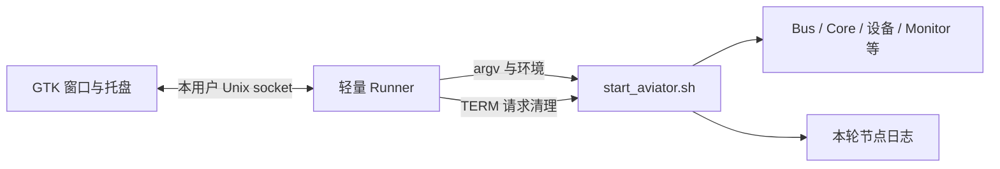

# AVIATOR GNOME 桌面启动器实现方案

日期：2026-10-19

状态：首版已实现于 `tools/aviator_launcher/`，已接入 CMake 安装；下文保留设计依据。验证范围与运行入口见工具 README。本次实现不自动创建 Git 提交或启动真实设备。

## 1. 目标与实现范围

在 `tools/aviator_launcher/` 实现一个普通用户运行的桌面小工具：启动后在 GNOME 顶栏托盘区显示图标，点击图标显示菜单，菜单打开配置窗口；用户选择启动模式、勾选附加功能后，点击“启动”调用现有 [start_aviator.sh](../scripts/start_aviator.sh)。窗口同时提供启动状态、日志入口和停止操作。

工具随现有 CMake 安装流程进入安装目录。既能从源码目录运行，也能从安装包运行，优先定位**与工具属于同一套源码或安装包的启动脚本**。安装包整体移动后仍可定位脚本和可执行文件。

启动顺序、节点互斥、权限提升、节点监督和清理继续由脚本负责。启动器负责选项、路径、调用和展示，不复制一套节点编排，不直接发送机器人业务命令。首版仅支持 `start_aviator.sh`；相机随动、标定、带宽测试等入口以后单独设计。

## 2. 已确认的项目条件

| 项目 | 当前实现 | 设计影响 |
| --- | --- | --- |
| 命令行参数 | simulation、rs422、fake-hand、headless、logger、tts、dry-run | UI 只生成这些实际支持的参数 |
| 参数约束 | simulation 与 fake-hand 互斥；headless 仅用于 simulation | 用控件约束和启动前校验共同保证 |
| 脚本位置 | 源码为 `<repo>/scripts/start_aviator.sh`；安装为 `<prefix>/share/aviator/scripts/start_aviator.sh` | 不能固定搜索 `<prefix>/scripts` |
| 运行资源根 | 脚本自身所在目录的上一级，启动后自动切换 cwd | 源码为 repo，安装为 share/aviator |
| 二进制默认值 | 源码自动搜索 `build/release/bin`、`build/debug/bin`、`build/bin`，完整 Release 优先，其余按编译时间选择；发布目录为 `<prefix>/bin` | 安装模式不得沿用某个源码 build 路径 |
| 参数以外的配置 | AVIATOR_BIN、CONDA_ROOT、CAMERA_PYTHON、MONITOR_BIN、TTS_CONFIG、START_DELAY | 高级选项以环境变量传入 |
| 单实例 | `${XDG_RUNTIME_DIR:-/tmp}/aviator-start-${UID}.lock`，由脚本及其相关进程持有 | 最终互斥以此为准，启动器不删除锁文件 |
| 停止流程 | 向脚本发信号触发 cleanup；先 Core 最多 15 s，再手节点最多 8 s，再其他节点 | UI 不对所有子进程同时 kill，不设置短于脚本清理过程的强杀计时器 |
| 日志 | 节点诊断日志在本次 `/tmp/aviator-start.*`；录制在资源根的 logs | UI 分开显示“运行日志”和“MCAP 录制” |
| 浏览器 | 脚本自动启动全屏 Chrome；不将 Chrome 纳入节点监督/清理 | 首版不提供脚本尚未支持的“关闭浏览器”开关 |
| 可选语音 | TTS 运行中退出不停止控制节点 | 可显示附加功能异常，不将整套运行误判为停止 |

以上依据为 [启动脚本](../scripts/start_aviator.sh)、[Release.cmake](../cmake/Release.cmake)、[ReleaseInstall.cmake.in](../cmake/ReleaseInstall.cmake.in)及[现有脚本测试](../tests/scripts_test.py)。部分旧说明与当前脚本不一致时，以代码为准。

本次环境只读检查结果：Ubuntu 22.04.5 LTS，系统 `/usr/bin/python3` 可加载 PyGObject、GTK 3.0、AppIndicator3；未发现 AyatanaAppIndicator3 Python typelib。**这不等于已经验证顶栏扩展启用或图标可显示**，实现时还要进行桌面会话检查。

## 3. 技术选型与 GNOME 兼容

首版采用 **Python 3 + PyGObject/GTK3 + AppIndicator3**，匹配当前 Ubuntu 22.04 环境，避免为一个启动面板引入完整 Web 服务或大体积桌面运行时。托盘封装为独立 `tray.py`，可兼容发行版提供的 AyatanaAppIndicator3；不在同一进程混用 GTK3/GTK4。

GNOME 顶栏图标通过 StatusNotifierItem/AppIndicator 宿主显示，通常由 [Ubuntu AppIndicator 扩展](https://github.com/ubuntu/gnome-shell-extension-appindicator)提供。工具不自行注入 GNOME Shell 扩展，也不自动修改用户的扩展设置。图标具体位置由桌面布局控制，不能保证固定在最右侧第几个位置。

选择 GTK3/AppIndicator3 是当前目标环境的兼容决策。[Ayatana 旧 GTK 库上游](https://github.com/AyatanaIndicators/libayatana-appindicator)已标记旧实现并建议新 GLib 实现；后续支持新发行版时再评估新的托盘后端，不要求当前工控机为此升级整套桌面。

启动时检测 GTK 和托盘后端、会话 D-Bus、StatusNotifierWatcher/宿主可用性。缺少托盘宿主或注册失败时，自动显示普通窗口并提示“当前桌面未提供托盘区域”；窗口模式仍可配置、启动和停止。宿主运行中消失时同样显示窗口，不能让应用只剩一个不可见后台进程。人工验收仍需确认实际图标渲染。

通过 [Gtk.Application](https://docs.gtk.org/gtk3/class.Application.html)实现应用单实例与二次启动唤起窗口；无窗口时使用 [GApplication hold](https://docs.gtk.org/gio/method.Application.hold.html)保持托盘运行。采用事件驱动，日志刷新有界，不使用高频忙轮询。

## 4. 用户界面与交互

### 4.1 托盘菜单

```text
AVIATOR · 未启动 / 启动中 / 脚本运行中 / 停止中 / 需要处理
────────────────────────────
配置与启动…
显示运行日志…
打开 Monitor
打开本次日志目录
停止本次运行
────────────────────────────
登录后显示启动器  [勾选项，默认关闭]
退出启动器
```

“配置与启动”只显示一个窗口，多次点击聚焦已有窗口。状态同时使用图标和文本表达，不仅依赖颜色；运行相关菜单按当前状态启用。登录自启动仅启动托盘工具，绝不自动执行机器人启动脚本。

### 4.2 配置窗口草图

```text
AVIATOR 启动器                          状态：未启动
程序来源：安装包 /opt/aviator             [选择位置…]
脚本：/opt/aviator/share/aviator/scripts/start_aviator.sh

设备模式   ( ) 真机：双手沿用配置
           ( ) 真机：模拟双手
           (●) 整机仿真
输入来源   [本机摇杆/键盘 ▾]  或 RS422

[ ] 隐藏仿真窗口（仍运行相机渲染与传输）
[ ] MCAP 录制
[ ] 离线语音提醒

▸ 高级选项：二进制目录、相机 Python、Monitor、语音配置、启动间隔
▸ 命令预览与脚本输出

配置摘要：整机仿真 · 本机输入 · 不录制 · 不启用语音
[预览启动命令]  [保存选项]                    [启动]
──────────────────────────────────────────────────
运行日志末尾…                               [停止]
```

首轮无保存配置时，建议选中整机仿真、其余附加项关闭；后续恢复同一来源保存的选项。明确 UI 的初始选择与脚本“无参数即真机”的默认值不同。用户点击启动就是执行操作，不增加重复确认弹窗；真机/仿真的当前模式始终清楚显示。

视觉实现使用浅灰背景与白色圆角卡片、深蓝标题区、青绿色主操作及选中状态。三种运行模式以并列卡片展示，附加功能用独立开关；路径和启动间隔折叠在高级选项。窗口顶部切换“启动配置 / 输出与日志”，底部固定配置摘要与启动/停止按钮，窄屏允许内容滚动。SVG 图标随包安装，界面样式仅作用于启动器自身。

运行时锁定本轮配置编辑和启动按钮；停止后可修改。关闭窗口通常只隐藏到托盘，不停止节点；没有可用托盘时，关闭动作明确提供“保持窗口”或“停止并退出”，避免失去操作入口。退出菜单在有活动运行时显示“停止并退出”，等待脚本清理完成；不提供含糊的“退出但丢下全部节点”。

### 4.3 选项到脚本的精确映射

| UI 项 | 参数/变量 | 约束与说明 |
| --- | --- | --- |
| 真机：双手沿用配置 | 不加 simulation/fake-hand | 未加 fake-hand 不代表强制真实手，system.yaml 中仍可能设置 fake_hand |
| 真机：模拟双手 | `--fake-hand` | 机械臂和相机仍按真机运行 |
| 整机仿真 | `--simulation` | 不启动真机 manipulator/独立手节点 |
| RS422 输入 | `--rs422` | 可与两类真机、仿真组合；串口路径仍来自既有 YAML |
| 隐藏仿真窗口 | `--headless` | 仅仿真启用；切回真机时清除。当前 simulation 会隐藏仿真窗口，但保留相机渲染/传输；脚本仍开 Chrome |
| MCAP 录制 | `--logger` | 不勾选也仍有运行诊断日志；录制策略来自 recording.yaml |
| 离线语音 | `--tts` | 音频包和 aplay 由脚本检查 |
| 预览启动命令按钮 | 在当前参数后增加 `--dry-run` | 独立一次预览操作，不作为持续保存的“运行模式” |
| 二进制目录 | `AVIATOR_BIN` | 目录选择，不提供任意命令输入 |
| 相机解释器 | `CAMERA_PYTHON` | 真机有效；应指向可执行的 Python 文件 |
| Conda 根目录 | `CONDA_ROOT` | 未显式设置 CAMERA_PYTHON 时用于脚本默认计算 |
| Monitor 程序 | `MONITOR_BIN` | 未覆盖时随 AVIATOR_BIN 计算 |
| 语音配置 | `TTS_CONFIG` | 仅启用语音时检查；不改写原 YAML |
| 节点启动间隔 | `START_DELAY` | 非负有限十进制秒，默认 2；拒绝 NaN/Inf/负数，UI 输出符合脚本正则的格式 |

不提供尚未存在的 `--no-camera`、`--no-monitor`、`--no-browser` 参数。需要这些能力时先扩展脚本并更新协议测试。高级页不提供自由 shell 片段或任意环境变量编辑器。

“预览启动命令”实际调用脚本的 dry-run 并展示输出。dry-run 不做完整可执行文件、权限和硬件可用性验证，因此预览成功不显示“所有设备已就绪”。

## 5. 源码与安装目录定位

### 5.1 两套布局

源码布局：

```text
<repo>/
  CMakeLists.txt
  scripts/start_aviator.sh
  config/
  tools/aviator_launcher/main.py
  build/bin/                   # 与 build/release/bin、build/debug/bin 一起参与自动选择
```

与当前 CMake 默认 GNUInstallDirs 对齐的安装布局：

```text
<prefix>/
  bin/
    aviator_launcher           # 新增可执行入口
    aviator_bus / aviator_core_managed / simulation / ...
  share/
    aviator/
      scripts/start_aviator.sh # 已有安装规则提供，不复制第二份
      config/
      nodes/camera/
      tools/aviator_launcher/  # 新增工具模块和随包资源
    applications/org.aviator.Launcher.desktop
    icons/hicolor/scalable/apps/aviator-launcher.svg
  release-version.json
  release-checksum.json
  SHA256SUMS
```

### 5.2 有边界的查找算法

1. 安装入口基于**自身真实路径**找到相对位置的 Python 入口；源码入口直接使用当前 `main.py`。不依赖进程 cwd 或用户 PATH 查找启动脚本。
2. 从 `main.py` 的固定相对布局得到资源根 `R`：源码时为 repo，安装时为 `<prefix>/share/aviator`。候选脚本唯一为 `R/scripts/start_aviator.sh`。
3. 校验候选是可读普通文件，并存在配套 `config/`。源码模式还核对根 CMake 标识；安装模式核对同包发布元数据和 bin 目录。缺少脚本或元数据时显示不完整位置，不自动回退到另一份源码。
4. UI 如显式“选择位置”，允许选择源码根、安装前缀或安装资源根，规范化为上述两类布局之一，并展示完整脚本/程序位置；不允许任意独立脚本替换入口。
5. 同时存在安装包和源码时，本工具所在位置优先。不要遍历 `$HOME`、所有父目录或磁盘寻找第一个同名脚本；尤其不要从 repo 内的 `build/release/dist` 越过安装根误命中 repo 脚本。
6. 正式启动前重新核对来源、文件和有效路径。旧的自定义绝对路径失效时要求在界面修正，不静默挑选另一个 build 目录。

所有路径先规范化、支持空格和中文；符号链接入口解析到真实安装位置。安装包移动后重新计算自动路径，自动值不保存成旧绝对路径。

源码模式在“二进制目录”留空时自动搜索 `build/release/bin`、`build/debug/bin`、`build/bin`。先根据当前模式和可选功能判断目录中所需程序是否均存在且可执行；完整的 Release 目录优先，其余完整目录按所需程序中最新的文件修改时间排序（作为最近编译时间依据，忽略目录时间和无关文件）。同时间按上述候选顺序确定选择，不跨目录拼接程序；显式指定 Monitor 时不要求候选目录提供 Monitor。

没有完整候选时，预览优先展示已有 Release 目录，其余已有目录按上述时间排序，完全不存在时展示原有 `build/bin`；正式启动的预检查报告具体缺失程序，不会启动不完整的一套。显式二进制目录始终覆盖自动选择，失效时不回退。每次预览和启动重新计算自动路径，启动实际使用预检查通过的同一套环境；预览输出展示注入的 `AVIATOR_BIN`。安装模式仍只使用同包 `<prefix>/bin`，直接调用脚本的原有默认行为不变。

首版支持当前项目默认 `bin + share/aviator` 布局和任意安装前缀，不声称支持任意绝对 GNUInstallDirs。若后续定制 bindir/datadir，须由 CMake 生成相对定位信息，并同步解决现有启动脚本自身对默认布局的假定。

## 6. CMake 安装集成

根 [CMakeLists.txt](../CMakeLists.txt)已经在最后调用 Release.cmake 完成打包；新增工具安装规则必须注册在该调用**之前**，使其包含在本次安装和 SHA256 清单中。

建议根 CMake 在 nodes 及工具子目录附近增加：

```cmake
option(AVIATOR_INSTALL_LAUNCHER "Install the GNOME desktop launcher" ON)
if(CMAKE_SYSTEM_NAME STREQUAL "Linux"
   AND AVIATOR_INSTALL_LAUNCHER
   AND TARGET aviator_core_control)
  add_subdirectory(tools/aviator_launcher)
endif()
```

与已有 start_aviator.sh 的安装条件保持一致：通信子集未提供完整 Core 启动入口时，不安装一个无法使用的桌面启动器。后续将该有效功能状态纳入 Release.cmake 的 feature 元数据。

`tools/aviator_launcher/CMakeLists.txt` 负责：

- 用 `configure_file(... @ONLY)` 生成 `aviator_launcher` 包装入口；安装到 `${CMAKE_INSTALL_BINDIR}`，通过 `install(PROGRAMS ...)` 保留可执行权限。
- 按清单安装 Python 模块、UI/图标资源和使用说明到 `${CMAKE_INSTALL_DATADIR}/aviator/tools/aviator_launcher`，不安装测试、缓存或开发配置。
- 安装 `.desktop` 和图标到标准 data 目录；使用相对 `DESTINATION`，支持 `cmake --install --prefix` 及打包暂存，不把构建机绝对路径写入安装产物。
- 不重复安装 start_aviator.sh，不增加另一个打包器；沿用现有 `aviator_release` 和清单生成流程。
- Python/GTK 是目标机运行依赖；打包机无图形桌面不应导致项目无法构建。运行时诊断依赖，发行包说明列出系统包需求。

依据：[CMake install](https://cmake.org/cmake/help/latest/command/install.html)、[GNUInstallDirs](https://cmake.org/cmake/help/latest/module/GNUInstallDirs.html)。实现只使用项目最低 CMake 3.22 已支持的功能。

包装入口使用 `/usr/bin/python3` 加 `-B`，从自身位置构造同包入口路径并转交参数，不依赖激活 Conda、不使用构建机 Python 绝对路径。相机继续使用配置指定的 CAMERA_PYTHON，两者分别管理。程序配置、日志、状态不写入安装目录，也不在安装后改写包内 desktop 文件，避免改变发布校验。

### 6.1 桌面入口与安装包移动

随包 `.desktop` 可使用 `Exec=aviator_launcher --show`、`Icon=aviator-launcher`、`Terminal=false`，适用于安装 bin 已在桌面 PATH、share 已在桌面搜索路径的系统部署。**仅把它放入本地 dist/share/applications，不意味着 GNOME 会自动发现它。**

对于任意目录下的便携安装包，提供显式“注册到应用菜单”操作或 `--register-desktop`：在当前用户应用目录创建派生快捷方式，Exec 和 Icon 指向本次安装的绝对路径，遵守 Desktop Entry 的转义规则；不通过 `sh -c` 拼接启动命令。安装包移动后工具本身仍能运行，但用户侧绝对路径快捷方式需要重新注册。可提供移除注册的对称操作。[Desktop Entry Exec 规范](https://specifications.freedesktop.org/desktop-entry/latest/exec-variables.html)

“登录后显示启动器”使用用户级 autostart desktop 条目，默认关闭；通过显式勾选写入，取消勾选只移除本工具管理的条目。CMake 安装不操作用户 HOME、不启用自启动。[Desktop Autostart 规范](https://specifications.freedesktop.org/autostart/latest/)

## 7. 启动参数生成与配置保存

选项模型统一生成 argv 与环境覆盖，预览和正式启动共用此模型。例如：

```python
argv = ["/bin/bash", str(script_path), "--simulation", "--logger", "--tts"]
env = build_effective_environment(options, selected_layout)
process = subprocess.Popen(
    argv, cwd=resource_root, env=env,
    stdin=subprocess.DEVNULL, stdout=run_log, stderr=subprocess.STDOUT,
    start_new_session=True, close_fds=True,
)
```

代码是实现示意，不表示本次已提供这些函数。实际调用不使用 shell=True；界面显示的命令字符串仅用于阅读/复制，不反向作为执行输入。

环境策略：从桌面环境保留 DISPLAY、WAYLAND_DISPLAY、DBUS_SESSION_BUS_ADDRESS、XDG_RUNTIME_DIR 等正常会话变量；对本工具支持的 AVIATOR 参数明确计算值，避免继承另一套工程残留的 AVIATOR_BIN 等覆盖。显示每个有效值及“自动/用户覆盖”来源。跨环境 PATH 问题由启动前诊断解释，不在后台 `source ~/.bashrc`。

配置保存到 `${XDG_CONFIG_HOME:-~/.config}/aviator-launcher/settings.json`，含 schema_version、窗口偏好及按来源区分的启动选项。自动路径保存为“自动”标记；只有用户明确覆盖的路径保存为绝对路径。配置损坏时提示并使用默认值，不启动脚本；写入采用临时文件 + 原子替换。

当前运行选项在启动时形成不可变快照。保存选项不启动程序；恢复上次配置也不启动。切换安装包/源码来源不能将旧 AVIATOR_BIN 静默带入新来源。

## 8. 进程管理与退出语义

### 8.1 一个界面进程和一个轻量运行管理进程

建议用独立 `runner.py` 管理本次脚本子进程，GTK 进程只负责交互。runner 是普通用户 Python 进程，不是 root 守护服务，也不编排各节点。这样 GTK 崩溃或 Shell 托盘重载后，可重新打开窗口连接同一个 runner，继续查看和停止本次运行。



runner 的控制 socket、锁和状态位于 `$XDG_RUNTIME_DIR/aviator-launcher/`，目录权限 0700，socket 0600，核对同 UID 对端。接口限于查询、提交结构化选项、停止和退出，不接受任意命令/任意 PID。请求长度和读写时间有上限。没有合法运行目录或桌面会话时返回明确错误，不退回公共可写 socket。

UI 使用 Gtk.Application 单实例；runner 另持有本用户全局单实例锁，保证两个包的 UI 也不能同时发起两次启动。第二份来源被打开时先展示已有来源与运行状态，不自动切换正在运行的安装包。脚本原有启动锁仍是跨工具、命令行和其他启动脚本的最终保护。

runner 不将锁 FD/socket FD 继承给脚本。脚本原有 lock FD 及节点进程组管理保持不变。脚本 stdout/stderr 写入本轮普通文件，runner 有界读取并转发摘要；GTK 退出不能关闭脚本正在使用的输出 pipe，也不会因 UI 日志刷新缓慢阻塞脚本。

### 8.2 状态与停止

状态集合：`IDLE → VALIDATING → STARTING → RUNNING → STOPPING → IDLE`；另有 `FAILED` 和 `NEEDS_ATTENTION`。启动完成标识只表示脚本完成了启动流程，不表示机器人已使能或业务状态 READY。业务状态在 Monitor 查看。

- 启动前 runner 校验布局、参数、需要的目录和文件；耗时操作不运行在 GTK 主线程。两次点击由状态机原子拒绝，不只依赖按钮禁用。
- 首版复用脚本“日志目录”“所有节点已启动”“TTS 已退出”“残留进程”等现有输出作为展示事件。解析器独立、有 fixture 测试、每轮只读本轮日志；解析失败显示“状态未确认”，不能只因进程还活着就显示启动成功。后续可给脚本增加可选结构化状态输出，但不是首版前提。
- 用户停止时，只向 runner 持有的当前脚本进程发一次 SIGTERM，让脚本按已有顺序 cleanup；重复点击幂等。不得 killall/pkill，也不得直接杀负 PID 的整组来跳过脚本清理。
- STOPPING 状态异步等待。当前脚本有 Core 15 s、手 8 s、其余节点等待及回收步骤，总耗时可超过 25 s；30 s 可用于显示“清理耗时较长”，不能作为强杀脚本的默认期限。
- runner 记录“主动停止”意图；由 TERM 正常退出的 143 可解释为用户停止结果，而不能单看非零码报启动失败。残留进程提示、启动锁仍占用等情况进入 NEEDS_ATTENTION，不报告完全停止。
- 主脚本运行中异常退出显示退出码和日志；不自动重启机器人。TTS 可选进程退出显示附加功能异常，保留脚本运行状态。
- UI 正常“停止并退出”须等 runner 完成清理。窗口隐藏不停止运行。会话注销/关机时尽力请求正常清理，但不承诺桌面或系统强制结束能提供完整等待时间。

runner 自身被 SIGKILL 后无法保证它继续监督；重开工具发现状态文件存在但控制端失联时显示“上次运行状态未知”，阻止盲目重启并提供日志位置。只靠历史 PID 文件或进程名不能安全接管/发信号；PID 复用时尤其不能据旧状态杀进程。首版不提供任意遗留进程强制接管功能。

## 9. 权限、安装目录写入与现有脚本配合

启动器和 runner 始终以普通用户运行，拒绝把整个 GTK 程序作为 root 启动。当前 start_aviator.sh 自行通过 stdin 提交内置 sudo 凭据，涉及启动、清理两条路径；首版兼容其现状，UI 不复制、展示或保存该凭据。认证失败原样展示错误与日志，不能用 UI 中一次 `sudo -v` 假定跨 setsid 会话和清理期间都会有效。

后续如改为系统认证代理，应单独修改脚本的整个提权/停止契约，再接 GUI；仅加一个密码框或只修改启动部分不足以完成兼容。本次不增加新的凭据存储机制。

安装支持还需解决一个已确认的问题：**当前启用 Logger 时，脚本写入 `$ROOT/logs`，在 root 所有的 `/opt` 或系统安装目录下可能不可写。** 因此建议同次实现增加一个小范围、向后兼容的脚本接口：

```text
AVIATOR_RECORDING_DIR
  未设置：保持现有 $ROOT/logs 行为。
  设置：MCAP 输出到指定绝对目录。
```

该变量已随首版实现加入脚本。启动器默认传入 `${XDG_DATA_HOME:-~/.local/share}/aviator/recordings`；允许用户选择其他可写目录。脚本在启动节点前完成创建和写入检查，dry-run 只展示不创建。避免启动大部分节点后才因 mkdir 失败被动清理。原有 recording.yaml 编码策略和图像伴随文件规则保持不变。

启动器自身日志/运行摘要放在 `${XDG_STATE_HOME:-~/.local/state}/aviator-launcher/`，临时控制状态放在 XDG_RUNTIME_DIR。节点日志沿用脚本输出目录。安装包只读运行验收还要检查 SDK/第三方其他落盘位置；仅修正 Logger 路径不能自动证明所有节点均可在只读安装包中运行。

## 10. 目录与模块职责

```text
tools/aviator_launcher/
  CMakeLists.txt
  README.md
  main.py                      # 系统 Python 入口、诊断/显示/注册等参数
  app.py                       # Gtk.Application、单实例、窗口生命周期
  window.py                    # 选项、摘要、日志和启动/停止按钮
  tray.py                      # AppIndicator 后端与无托盘回退
  options.py                   # 纯数据模型、互斥校验、argv/env 构造
  paths.py                     # 源码/安装布局识别和同包定位
  settings.py                  # 用户选项的原子保存
  runner.py                    # 本用户控制端、脚本子进程与状态机
  protocol.py                  # 有界本地请求/应答与版本
  desktop.py                   # 用户侧桌面入口/自启动注册
  assets/aviator-launcher.svg
  aviator_launcher.in           # 可重定位的安装包装入口
  aviator-launcher.desktop.in
  tests/                       # 路径、参数、runner、安装契约测试
```

实现采用清晰的小模块，不引入通用插件框架、远程管理服务或数据库。UI 和托盘后端之外的模块不依赖 GTK，便于在无桌面的 CI 中验证。

建议 CLI：`--show` 显示窗口，`--tray` 登录后驻留，`--check` 输出依赖/布局诊断，`--register-desktop` 和 `--unregister-desktop` 管理当前用户入口。CLI 默认不支持自动启动机器人；应用菜单或登录启动都只能打开工具。

## 11. 测试与验收

自动测试使用 fake 脚本/节点，不连接真实机械臂：

| 范围 | 验收点 |
| --- | --- |
| 选项模型 | 所有合法组合准确映射；simulation/fake-hand、headless/真机非法组合拒绝；预览不污染正式 argv |
| 脚本契约 | 对真实脚本执行 dry-run 验证模式、配置和参数；参考已有 scripts_test.py，验证没有节点启动和文件写入 |
| 路径 | 源码、默认安装、任意 prefix、安装包位于 repo/build 下、软链接入口、中文/空格路径；绝不跳到另一份脚本 |
| 重新定位 | 安装包 A 复制/移动到 B，删除/隐藏源码位置后仍定位 B 内脚本和 bin；旧用户覆盖路径失效时显式报错 |
| 调用边界 | 路径中的 shell 特殊字符作为普通参数；cwd/env 正确；控制接口不允许任意命令与跨 UID 请求 |
| 生命周期 | 连续点击只启动一次；关闭窗口后可重开；UI 崩溃后 runner 保留并可重连；runner 失联不猜测接管 |
| 停止 | 向脚本发一次 TERM，保留既有 Core→手→设备顺序；长清理不被 UI 强杀；只影响本次运行 |
| 失败与降级 | 缺程序、音频包、权限、锁占用、脚本中途退出、TTS 单独退出、日志解析失败、残留节点显示准确 |
| 配置/日志 | 保存与启动分离；坏配置可恢复；日志内存有上限；UI/runner 日志做大小轮转，既有节点日志不由工具擅自删除 |
| 安装/发布 | launcher 安装条件与脚本一致；包内文件进入 SHA256 清单；运行前后发布校验不因用户配置、pycache 或快捷方式改变 |
| 只读安装 | 启用 Logger 时使用用户录制目录；不可写输出在启动任何节点前失败 |
| 桌面注册 | Exec 转义、用户级注册/卸载、移动后重新注册、自启动仅显示工具 |

人工桌面验收覆盖目标 Ubuntu/GNOME 的 X11 和 Wayland（按实际部署会话），以及扩展启用、禁用、运行中重载。验证右上角图标、菜单可点击、窗口聚焦、无托盘回退、缩放/中文显示。图形依赖缺失时应清楚报错，不影响整个 AVIATOR 构建安装。

运行占用目标是空闲时无忙轮询、日志内存有界、无持续 CPU 活跃；先测 GTK/托盘本身的正常基线，再设回归门限，不为轻量启动器虚构固定内存承诺。

## 12. 实施步骤与完成标准

1. 先实现纯逻辑的布局识别、选项模型和 dry-run 预览，复用已有脚本契约测试。
2. 实现 runner、日志/状态和有序停止，用 fake 脚本覆盖生命周期。
3. 接入 GTK 窗口与 AppIndicator 菜单，完成无托盘回退和二次启动唤起。
4. 增加 AVIATOR_RECORDING_DIR 的脚本兼容扩展并验证早期可写性检查。
5. 在根 CMake 和工具子目录注册安装，接入现有发布清单；验证可重定位、只读安装及用户桌面注册。
6. 在目标 GNOME 会话人工验收；最后用整机仿真验证完整启动/停止流程。

完成后用户可从源码入口或安装包 `bin/aviator_launcher` 打开工具，使用“顶栏图标 → 配置与启动 → 勾选 → 启动”的流程；工具自动选择同套安装中的脚本和程序，停止时复用脚本已有清理过程，运行数据落到用户可写目录。
