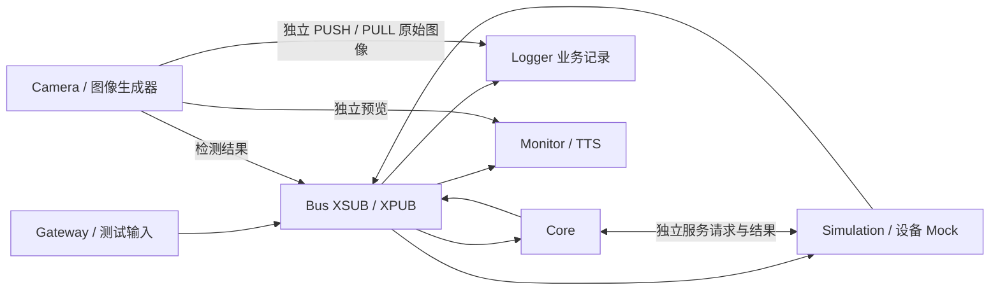

# AVIATOR 软件代码质量评估测试方案

日期：2026-10-19

状态：内部工程评审稿；尚未执行本方案中的专项测量

代码调研基线：`b3540ca85`，根 CMake 项目版本 `6.0.0`

## 1. 评估范围与结论形式

本方案按已确认的要求设计：**仅评价软件代码质量，用于内部工程验收与发布准入**。评价对象包括 C++/Python/JavaScript 代码、进程间协议、并发与资源管理、构建配置及交付脚本。CPU、内存、磁盘和网络测量用于判断这些代码组成的软件系统是否高效、稳定。

不评价机械臂物理精度、实体轮盘带宽、抓握效果、机械安全距离、飞行品质、硬件可靠性；不开展适航或功能安全认证。设备相关软件通过 Mock、fake 设备、PTY 和 MuJoCo 验证。仿真通过只代表相应软件路径通过，不能替代真实 SDK 内部或实际硬件行为的验证。

建议交付五组结果：

1. **正确性与覆盖证据**：需求/风险—用例—断言—覆盖率的对应关系。
2. **代码缺陷与规范符合性报告**：静态分析、内存错误、未定义行为、线程竞争、协议异常处理，以及 Google 编程规范的排版、命名、语言用法检查。
3. **多进程性能报告**：总线及业务端到端延迟、抖动、积压、失效处理和服务完成语义。
4. **整套软件资源画像**：系统与各进程 CPU、内存、磁盘、网络占用及运行时趋势。
5. **发布判定**：通过、失败、证据不足；缺陷整改和同条件复测结果。

不建议先计算一个“软件质量总分”。非法命令被执行、内存越界、死锁等问题不能被较低的 CPU 占用抵消。先执行硬性缺陷门禁，再比较资源与性能基线。

## 2. 方法依据与项目现状

### 2.1 标准的使用方式

采用 [ISO/IEC 25010:2023 产品质量模型](https://www.iso.org/standard/78176.html)组织评价维度；参考 [ISO/IEC 25023:2016 质量测量](https://www.iso.org/standard/35747.html)定义指标，参考 [ISO/IEC/IEEE 29119-2:2021 测试过程](https://www.iso.org/standard/79428.html)组织计划、执行、缺陷跟踪和报告。以下是针对 AVIATOR 的工程裁剪，不声称完成标准逐条符合性评定。

这些标准不直接规定本项目应达到“80% 覆盖率”或“60% CPU”。本文给出的数值是**首次内部评估的建议值**，须与首次基线一起评审，后续固定测试条件并跟踪回归。

代码格式与编程风格按语言**严格采用 Google 官方开源编程规范**：[C++](https://google.github.io/styleguide/cppguide.html)、[Python](https://google.github.io/styleguide/pyguide.html)、[JavaScript](https://google.github.io/styleguide/jsguide.html)及 [Shell](https://google.github.io/styleguide/shellguide.html)。检查不仅包括排版，还包括文件与符号命名、控制流、代码组织和注释。第 11.2 节定义检查设计；执行前归档官方规范的版本/提交号或内容快照与校验值，后续复测使用同一版本。Google 未规定的 CMake、配置文件等约定单列为项目规则，不冒称 Google 要求。

### 2.2 从代码和配置确认的特征

| 特征 | 当前依据 | 对评价方法的影响 |
| --- | --- | --- |
| C++ 为主要实现，辅以 Python 和 Web JavaScript；根构建为 C++20 | [CMakeLists.txt](../CMakeLists.txt)、[tests](../tests/) | 三类代码分别统计，不把只构建通信子集的覆盖率作为全项目覆盖率 |
| 独立 XSUB/XPUB Bus，应用消息为 Topic + JSON 两帧 | [transport.cpp](../common/transport.cpp)、[protocol.hpp](../common/protocol.hpp) | 单独测试转发、序列化和业务消费；关注多帧完整性、慢订阅者及尾延迟 |
| 普通 socket 默认发送/接收 HWM=8，Bus 两侧=64，LINGER=0，CONFLATE=0 | [transport.hpp](../common/transport.hpp)、[transport.cpp](../common/transport.cpp) | 测试有界缓存与丢弃行为；不能把队列扩大当作延迟问题的通用修复 |
| 本机 TCP 为默认控制传输，Header/Origin 有 sequence、sample_mono_us、clock_id 等字段 | [runtime.cpp](../common/runtime.cpp)、[protocol.hpp](../common/protocol.hpp) | 复用时间和身份字段建立跨进程测量；当前不假定跨主机单调时钟可相减 |
| 本机摇杆发布约 50 Hz，RS422 链路 80 Hz，臂消息约 100 Hz，本地执行按 1 ms 设计 | [Gateway](../nodes/flight_gateway/README.md)、[Manipulator](../nodes/manipulator/README.md)、[system.yaml](../config/system.yaml) | 分别评价各层周期；不能要求所有进程均为 1 kHz，也不能从 100 Hz 反馈反推每个 1 ms 回调 |
| 真机配置 command/origin 超时为 50/100 ms；仿真为 100/200 ms | [system.yaml](../config/system.yaml)、[system-simulation.yaml](../config/system-simulation.yaml) | 超时边界是代码契约；两组配置分别测，不把仿真宽限结果套用到真机配置 |
| 原始图像通过独立 PUSH/PULL 通道到 Logger，不走控制 Bus；另有预览通道 | [recording.yaml](../config/recording.yaml)、[camera.yaml](../config/camera.yaml) | 分别测控制、图像、预览与存储；逻辑分流仍共享 CPU、内存和磁盘资源 |
| Logger 默认 compact、彩色 compressed、软件 H.264、8 Mbps，默认不录深度 | [recording.yaml](../config/recording.yaml) | 要报告实际模式；软件编码可能是主要 CPU 消费者，录制容量不能只看业务 JSON |
| 已有大量协议、状态机、仿真、进程级及浏览器测试 | [tests/CMakeLists.txt](../tests/CMakeLists.txt)、[tests/README.md](../tests/README.md) | 在已有测试上增加覆盖统计、负载和资源测量，无需另建一套重复功能测试 |
| 现有格式配置为 LLVM、4 空格、100 列；静态检查尚未形成 Google 完整规则映射 | [.clang-format](../.clang-format)、[.clang-tidy](../.clang-tidy) | 与本方案的 Google 目标存在差距；不能将现有工具通过当作规范符合性通过 |

调研中发现，部分早期 README/启动注释仍写“RS422 未实现”或旧构建信息；当前代码已经实现 RS422。测试清单应以当前源码和新配置生成的 CTest 清单为准。旧 `build/` 目录可能缺少新注册测试，不能据其数量判断当前代码的测试完整性。

特别标记两项配置/实现边界：当前 `robot.yaml` 的 `collision_check_enabled=false`，因此碰撞检查代码需要在隔离测试配置中显式启用才能取得覆盖；`aviator_replay` 当前仍是占位目录，不能把“自动回放复现”列为已经具备的测试能力。

## 3. 评价维度与优先级

P0 为首次验收必做，P1 为发布前补齐，P2 为基线形成后完善。

| 优先级 | 维度 | 主要指标与检查对象 | 方法/工具 |
| --- | --- | --- | --- |
| P0 | 功能正确性 | 协议解析、数值边界、状态转换、错误码、配置加载、授权与超时逻辑 | CTest、Python 单测、真实 ZMQ 子进程、Mock/PTY/MuJoCo |
| P0 | 测试充分性 | 需求覆盖、行/函数/分支覆盖、状态与转换覆盖、异常路径覆盖 | GCC/gcovr 或 Clang/llvm-cov；Python coverage；Web 覆盖单列 |
| P0 | 编程规范符合性 | 文件/符号命名、排版、逻辑分支与判断、头文件/导入、注释及语言用法；详见 11.2 | Google 规范映射、格式差异检查、AST/lint、人工逐项审查 |
| P0 | 内存正确性 | 越界、释放后使用、重复释放、泄漏、异常退出清理 | ASan/LSan、UBSan；Heaptrack 定位分配与保留内存 |
| P0 | 并发正确性 | 数据竞争、死锁、线程退出、数值快照一致性、socket 线程归属 | 独立 TSan 构建、并发压力、取消/重启测试 |
| P0 | 多进程健壮性 | 断流、挂起、重启、慢消费者、过期/重复消息、故障隔离 | 可重复故障注入、时序和结果断言 |
| P0 | 性能与资源 | 总体及分进程 CPU/内存/磁盘/网络；关键链路 p99、超时与连续漏周期 | 系统采样、端点埋点、perf/Hotspot、Heaptrack |
| P1 | 可维护性 | 高风险复杂函数、重复逻辑、编译警告、依赖边界、说明与代码一致性 | compile_commands、clang-tidy、人工审查 |
| P1 | 输入安全性 | JSON/二进制超限、异常 UTF-8/NaN、深嵌套、伪造身份、HTTP/文件路径输入 | 模糊测试、边界用例、网络暴露面审查 |
| P1 | 兼容与交付 | 协议版本、配置兼容、安装包完整性、清洁环境启动/退出 | 发布校验脚本、配置矩阵、安装目录测试 |
| P1 | 可观测与可诊断 | 错误可定位、丢弃/拒绝有原因、缓存时间不冒充新采样、日志有界 | 故障注入后核对日志、计数与时间戳 |
| P2 | 测试有效性 | 关键逻辑变化能否被测试发现 | 小范围变异测试，如反转超时比较、去掉 epoch/范围检查 |

功能数值测试应使用独立预期值、已知边界或不变量。例如 FK/IK 往返、角度单位/符号、q/dq/ddq 连续性、有限值与范围约束。避免用被测实现计算同一预期结果后再断言相等。实体跟踪误差和机械带宽不属于本方案。

## 4. 测试分层、构建与环境

### 4.1 四层测试

| 层级 | 范围 | 能回答的问题 |
| --- | --- | --- |
| L1 单元/组件 | 编解码、InputGuard、状态机、规划、队列、配置、资源释放 | 给定输入时，代码的结果与异常处理是否正确 |
| L2 多进程集成 | 真实 Bus + 测试发布/订阅者、真实服务进程 + fake 对端、PTY | 消息和生命周期跨进程后是否仍正确 |
| L3 软件系统 | Bus + Managed Core + Simulation/fake 设备 + Gateway 测试输入 + 可选 Camera/Logger/Monitor/TTS | 整套软件在正常、负载和故障情形下是否协同运行 |
| L4 长稳/发布 | 固定配置长时间运行、反复启动退出、干净目录安装与校验 | 是否存在累积泄漏、偶发失败及交付缺项 |

每层都需要断言。进程“没有崩溃”、测试发布器“成功发出消息”、网页“可以打开”都不足以证明业务结果正确。

### 4.2 构建必须分开

| 构建 | 用途 | 注意点 |
| --- | --- | --- |
| 普通优化构建 | 资源占用、延迟和长稳验收 | 使用发布一致的编译选项；保留独立符号文件 |
| 优化 + 调试信息 | perf/Hotspot、Heaptrack 定位 | 若改为 RelWithDebInfo 或加 frame pointer，记录与发布构建差异，并复测无采集器基线 |
| coverage | 结构覆盖统计 | 运行变慢，不能据其延迟判定发布性能 |
| ASan + UBSan | 内存和未定义行为缺陷 | 仿真/Mock 运行，不与 Heaptrack 同时采集 |
| TSan | 并发缺陷 | 与 ASan 分开构建；未插桩 SDK/依赖的内部行为是检测盲区 |

当前未发现统一 coverage/sanitizer 专用 preset，需要后续新增。已有部分源文件在 Debug 下仍显式使用 `-O2`，因此只设置 Debug 或全局 `-O0` 不足以证明全部文件关闭优化。实施时检查 `compile_commands.json`，将插桩准确应用到项目自有目标，明确第三方与生成代码范围。

### 4.3 固定条件与统计规则

- 固定代码 SHA、dirty diff、二进制校验值、编译器/依赖版本、完整配置及随机种子。
- 记录 CPU 核数/型号、内存、磁盘类型、OS/内核、调度策略、亲和性、功耗模式、GPU/编码模式。机器是实验环境，不是本次被测产品。
- 每次测试用独立工作目录、端口、锁文件和配置副本；不连接部署中的控制总线，不启动真实运动入口。
- 性能测试先预热 5 分钟，稳态采集 15 分钟，同条件至少 3 次；启动阶段另报。长稳初次 8 小时，发布候选建议 24 小时；这些是软件筛查时长，不是任务续航要求。
- 常规系统资源每 1 秒采样，PSS 可每 5～10 秒采样以降低读取成本；亚毫秒问题依靠事件时间戳，不能用 1 秒采样分析。
- 报告均值、中位数、p95、p99、最大值、样本数、总时长及失败数；p99.9 仅在足够样本时列出（建议至少 10 万个，仍说明尾部样本有限）。
- 每次运行单独统计再比较，保留最大值；不要平均各进程/各轮次的 p99 作为总体 p99。负载生成器也记录实际发送率，防止被测端变慢导致输入自动减量。
- 分位数只覆盖收到的有效样本时，必须同时报告丢失、拒绝、超时及未完成数，避免遗漏最差请求。
- 正确性测试可适度并行；性能测试独占测试资源，不与编译、其他性能用例同时运行。

## 5. 覆盖率与测试质量

### 5.1 统计口径

分别给出自有 C++、Python、Web JavaScript 的行/分支覆盖，以及模块明细。自有可交付代码是分母；第三方、生成代码、测试自身可排除，但保留排除清单。`examples/`、`tools/` 中如有实际交付或生产链接的自有实现，应纳入相应模块，不能简单按目录一律排除。

未编译目标、未启用功能和缺失依赖必须标记“未测/未构建”，不能从报告中消失。通信子集、完整仿真、设备适配 Mock 分别报告，再按明确源码清单汇总；相同代码多次执行合并计数，不重复计算分母。

建议首次目标：

| 范围 | 初始建议 | 配套要求 |
| --- | --- | --- |
| 自有业务代码整体 | 行覆盖 ≥80%，分支覆盖 ≥70% | 先建立真实基线，列出未覆盖热点；不凭总体数值放行关键缺陷 |
| 协议校验、授权/时效、状态机、设备本地失效处理 | 行覆盖 ≥90%，分支覆盖 ≥85% | 已识别关键风险用例和合法/非法状态转换全部覆盖 |
| 新增/修改代码 | 改动行覆盖建议 ≥90% | 变更必须有相应结果断言；纯声明/生成代码等合理豁免留记录 |

单独检查 `age < / == / > timeout`、空/满队列、重启序号、过期 origin、错误 epoch、NaN/Inf、长度上下界、取消与异步完成竞争等条件。对关键复合布尔判定建立条件组合表；不把普通分支覆盖称为 MC/DC。

### 5.2 多进程覆盖的落地要求

使用 GCC 时，覆盖编译与链接均需覆盖选项；多线程计数可使用 `-fprofile-update=atomic`。正常结束会影响覆盖数据落盘，故障测试中 `SIGKILL` 的子进程不能被误认为“没有执行”。对正常退出路径与强杀路径分开标注；每轮隔离 profile 输出，避免旧数据污染和并发写入冲突。实现依据见 [GCC instrumentation](https://gcc.gnu.org/onlinedocs/gcc-15.2.0/gcc/Instrumentation-Options.html)。

使用 Clang 时按进程设置独立 `LLVM_PROFILE_FILE`（如带 `%p`、`%m`），统一合并并传入对应的全部二进制/库。两种工具链选一种作为长期基线，不混用结果口径。

Python 子进程需要单独启用 coverage 收集和合并，仅覆盖父测试脚本不能代表覆盖了 Camera 等被测节点。Web 测试单独报告业务 JS 覆盖；Python 发起的 C++ 进程测试，其 C++ 覆盖仍依赖 C++ 插桩。

覆盖率报告需同时保留原始数据、HTML、机器可读摘要、源码列表和豁免原因。[gcovr 过滤机制](https://gcovr.com/en/stable/guide/filters.html)可用于限定自有代码；不要通过大范围排除异常分支提高数值。

## 6. ZMQ 多进程架构专项评价

### 6.1 分开测量四条路径



1. **传输微基准**：测试 PUB → Bus → 测试 SUB，不带业务计算；另测直接 PUB → SUB 作为对照，估计引入 Bus 后的增量开销。
2. **真实业务链路**：输入 → Gateway/Core → 设备软件接纳/使用 → 反馈，不以旁路 SUB 的到达时刻代替设备时刻。
3. **服务链路**：分别统计请求到回复、请求到完成；`ACCEPTED` 不是完成，超时不是确定失败，更不能自动换新请求 ID 重做动作。
4. **图像/存储旁路**：测采集/生成 → Logger 接收 → 编码 → 文件写入，同时观察其对控制链路的干扰。

### 6.2 测量点与关联方法

建议新增可开关的轻量 trace，以下字段为设计项，不表示目前已经完整提供：

| 时间点 | 定义 |
| --- | --- |
| `t0` | 输入原始采样时刻，保留现有 sample_mono_us/origin 语义 |
| `t1` | 生产者开始发送该应用消息前 |
| `t2` | 业务消费者收到完整两帧后 |
| `t3` | 完成协议/授权/时效校验并接受 |
| `t4` | 执行线程/Mock 首次实际取用对应命令或对应目标版本 |
| `t5` | 对应反馈在观察端收到 |

统计 `t2-t1`（传输及排队）、`t3-t2`（校验）、`t4-t3`（软件交接）、`t4-t0`（原始输入到软件使用）、`t5-t0`（可观察反馈闭环）。`t4` 表示软件使用，不表示实体机械动作完成。不同阶段可流水重叠，不能任意拼接不同消息的时间戳求和。

使用 `(topic, publisher_id, session_id, sequence)` 区分传输样本，使用 origin、control_epoch 和现有命令/执行游标关联因果；服务按 request_id 关联。session 在测量中用于分段，不代表当前实现以 session 作为授权条件。一个输入生成多个输出或一个目标覆盖前一目标时，记录对应关系。缺少精确映射时输出“不可归因”，不根据时间邻近强行匹配。

同机只使用同一 `clock_id` 对应的单调时间计算时差，UTC 用于查日志。若未来跨主机，另设计时钟同步误差预算或同源 RTT 测量；不能简单将 RTT/2 当成准确单程延迟。

实时/高频路径只写预分配的固定大小记录，后台批量导出；环形队列溢出必须计数，不同步打印、不写盘、不新增 JSON 分配。可复用已有 TargetTrace 思路，但需要新增跨进程关联与分布统计。采集开/关各运行一次检查扰动；trace 丢失时标明结果不完整。

### 6.3 不能省略的 ZMQ 测试语义

- PUB/XPUB 在高水位下可能丢弃消息，`send()` 返回成功不证明 SUB 收到；本项目注释也明确不代表执行。按发送、接收、接受、覆盖、使用分别计数。[ZMQ socket 文档](https://libzmq.readthedocs.io/en/latest/zmq_socket.html)
- HWM 是按 peer 的消息数量限制，实际 TCP 缓冲行为还受传输影响，不能当成精确的字节内存上限。记录实际消息大小、peer 数和应用队列峰值。[ZMQ HWM 文档](https://libzmq.readthedocs.io/en/latest/zmq_setsockopt.html)
- 当前是两帧消息，不启用不支持 multipart 的 `ZMQ_CONFLATE`。要验证业务“最新值”处理，应在应用层确认消息完整后测量覆盖行为。[ZMQ CONFLATE 文档](https://zeromq.github.io/libzmq/zmq_setsockopt.html)
- socket connect 或 Bus READY 不能证明订阅已传播。稳态微基准先确认探测消息到达，再清零计数；启动/晚加入丢失另做独立用例。
- 连续 Servo 最新目标、有限轨迹窗口、状态遥测、离散服务请求的验收语义不同。连续目标允许明确记录的覆盖，有限窗口要求执行连续性，服务要求同请求不重复执行；不能统一用“零丢包”评估所有路径。
- PUB 丢弃、应用主动覆盖、业务拒绝、测试采集器漏记要分开。sequence 缺口只能表明观察缺失，单独看一个 SUB 不能定位丢在哪一层。

### 6.4 负载矩阵与指标

先跑真实业务典型报文，再用合成报文定位极限。131072 字节是当前 JSON payload 上限；边界测试保留合法消息与故意超限消息两组。

| 变量 | 建议取值 | 观察重点 |
| --- | --- | --- |
| 消息大小 | 实际 p50/p95 大小；合成 1/16/64/128 KiB | JSON 成本、带宽、内存、上限拒绝 |
| 输入频率 | 实际配置 1×、2×、5×，再逐级加压找拐点 | 达到期限的最大可持续负载，不只看最大 msgs/s |
| 订阅数 | 1、实际部署数、2 倍实际数 | Bus 扇出与 CPU、字节数增长 |
| 消费速度 | 正常，暂停 20/50/100/500 ms，极慢/不读 | 队列、最新有效值、连续断流、健康订阅者受扰 |
| 功能组合 | 控制；加 Monitor；加相机；加 Logger；加浏览器/TTS | 每个旁路功能的增量资源与尾延迟 |
| 系统争用 | 有界 CPU/内存/磁盘负载，分别和组合注入 | 超时保护、恢复与服务可用性 |
| 生命周期 | 订阅晚加入，Bus/Core/设备逐个重启，进程挂起 | 就绪时间、会话分段、旧消息拒绝、显式恢复 |

输出吞吐量、有效吞吐量、p50/p95/p99/max 延迟、输入年龄分布、接收/使用间隔、序列缺口、主动覆盖、拒绝原因、连续无有效数据最长时间。对周期任务记录 `实际开始-计划开始`、执行耗时、结束超期数及最长连续超期，不能仅用平均频率评价抖动。

对于 1 ms 设计路径，采用软件执行循环/SDK Mock 回调的直接计时；报告开始抖动、工作耗时和漏周期，并审查是否出现阻塞、分配、日志或不受控循环。仿真未达到 1 ms 时先区分物理引擎计算与应用代码开销，不声称获得真机硬实时保证。

## 7. 整套软件资源测量与建议区间

### 7.1 统计边界

“整套软件”包括本次运行的全部节点、它们的子进程、Python 相机进程、编码/语音子进程；实际使用 Monitor 浏览器时，浏览器及 renderer 也纳入。采集工具单列开销。使用测试启动器维护 PID/启动时间清单，或专用 cgroup 跟踪生命周期，不只采样启动脚本 PID，也不依赖容易误匹配的进程名。

同时报告：①机器整体；②AVIATOR 进程集合；③各进程及关键线程。MuJoCo 属于软件测试环境，计入“仿真整套软件”结果但单列其成本，不能推定为真实设备部署占用。无 SDK 硬件连接时，明确适配层未执行的部分。

建议采集来源如下；每条时序记录同时携带 run_id、单调时间、PID 与进程启动时间，避免 PID 重用后串接数据。

| 资源 | 采集来源 | 需要保存的数据 |
| --- | --- | --- |
| CPU | pidstat、mpstat、`/proc/<pid>/stat`，可用时使用 cgroup CPU 统计 | 进程/线程 CPU 时间、整机与每核占用、上下文切换、调度/限额节流 |
| 内存 | `/proc/meminfo`、`/proc/<pid>/smaps_rollup`、cgroup 内存统计 | MemAvailable、RSS/PSS、匿名/文件映射、swap、缺页；Heaptrack 另存堆分配 |
| 磁盘 | iostat、pidstat I/O、`/proc/<pid>/io`、输出文件大小采样 | 应用逻辑写入与设备实际写入分别统计、吞吐、队列、await、文件增长及余量 |
| 网络 | sar 网络统计、`/proc/net/dev`、TCP 统计、必要时限定端口抓包 | 每接口双向字节、drop/error、重传；应用按 topic/来源记录有效字节和消息数 |
| 其他资源 | `/proc/<pid>/fd`、task 目录、socket 状态；GPU 使用厂商工具 | FD/线程/连接数、进程退出；使用硬件编码时单列显存/编码器负载 |

CPU、内存、磁盘可以结合进程统计归因；系统网卡计数不直接提供每个进程的网络归因，若需要这项明细，须补应用计数或受支持的 tracing，不能凭接口总量分摊给各节点。

### 7.2 首次评价的合理区间

下表按固定负载、预热后稳态测量，给出资源余量的工程建议。**不是当前实测数据，也不是标准规定的上限**。无目标硬件规格时，不预测“总共必需几核、几 GB”。对低于建议值但存在积压/超时的系统仍判为异常；合理工作负载下更低的资源使用通常是好结果。

| 指标 | 建议正常区间/目标 | 需要调查的表现 |
| --- | --- | --- |
| 整机 CPU，按全部逻辑核归一到 0～100% | 稳态均值 0～60%，1 秒采样 p95 ≤80%；保留突发余量 | 长时间 >80%，或整体不高但关键线程所在核持续饱和、期限违约 |
| 单进程 CPU | 单列消耗的“核数”，按功能做对比，不设统一百分比 | 空闲时忙轮询；开启一个旁路功能后关键路径退化 |
| 系统可用内存 MemAvailable/MemTotal | 稳态 ≥30%，峰值负载仍 ≥20% | 持续低于 15%、OOM、持续 swap in/out 或 major fault 与延迟尖峰同时出现 |
| 软件集合内存 | 报告 ΣPSS、各进程 RSS/PSS、峰值与 MiB/h 趋势 | 稳态同阶段基线持续抬升；重复任务结束后无法回到稳定平台 |
| 磁盘持续写入带宽 | 正常峰值窗口建议不超过同盘实测可持续写带宽的 50% | 写队列增长、写延迟持续升高、业务记录丢失；短时 page cache 接收速率不代表落盘能力 |
| 磁盘容量 | 整个计划采集结束后仍保留 ≥20% 空间；本次产物预算取预计量的 ≥1.5 倍 | 剩余可录时长不足测试计划；日志/partial 文件无边界增长 |
| 磁盘时延/系统 iowait | 不设跨 SSD/HDD 通用毫秒值；需稳定且不引发业务积压 | 同负载较基线明显恶化；不能仅凭 NVMe `%util=100` 判断已经饱和 |
| 物理网卡 | 每个方向稳态 ≤链路速率 30%，1 秒采样 p95 ≤50% | 高重传、drop/error、新鲜度超限，即使带宽利用率很低也需调查 |
| loopback/本机 IPC | 单列 MB/s、msgs/s、CPU 和延迟，无“网卡占用率”门限 | 不应把 loopback 流量算成机器人网卡的物理负载 |
| 线程/FD/socket 数 | 预热后稳定；重连和重复任务后回到稳定范围 | 随每轮任务或重启单调增加；上限耗尽 |

进程 CPU 采用单核口径时可超过 100%。统一换算：`使用核数=ΔCPU秒/Δ墙钟秒`，`整机容量占比=使用核数/逻辑核数×100%`。机器整体 busy 与 iowait 分列，不能混用不同工具的口径。RSS 相加会重复计算共享页，进程集合优先看 PSS；内核缓冲/页缓存还需结合系统或 cgroup 数据，不能仅用 Heaptrack 的堆大小代表总内存。

内存斜率不直接设置宽松的“每天允许泄漏多少”。先测自然波动，再重复同一任务，比较各轮结束后的同阶段基线和未释放分配。持续增长需解释为有界缓存或修复泄漏；24 小时无明显增长也不是长期零泄漏证明。

### 7.3 基于当前图像配置的容量估算

按 `1280×720×30 fps`，使用十进制 MB/GB，不含信封、MCAP、业务记录、文件系统开销：

| 数据 | 计算 | 原始数据量 |
| --- | --- | --- |
| RGB8 | 1280×720×3×30 | 82.944 MB/s，约 298.6 GB/h |
| Z16 深度（额外开启时） | 1280×720×2×30 | 55.296 MB/s，约 199.1 GB/h |
| RGB8 + Z16 | 两者合计 | 138.240 MB/s，约 497.7 GB/h |
| 8 Mbps 彩色压缩目标 | 8,000,000÷8 | 约 1 MB/s，3.6 GB/h，实际码率可波动 |

当前默认只录彩色，软件 H.264 编码；8 Mbps 不是文件大小硬上限。尤其注意：**Camera → Logger 仍传原始帧，压缩发生在 Logger 内**，所以磁盘约 1 MB/s 不意味着这一内部通道也仅 1 MB/s。实际 RGB/深度配置、业务消息、预览和编码缓冲都需另外计入。

Logger 应用业务队列预算 16 MiB、图像队列 256 MiB；后者按连续原始彩色速率仅约容纳 3.2 秒数据，RGB+深度约 1.9 秒，尚未考虑其他限制。这是容量量级估算，不是可承诺的最长缓存时间；ZMQ HWM、编码及其他内存仍需测量。不能把两项相加作为进程 RSS 上限。

物理网卡分别统计左右机械臂网络接口（如该测试环境有实际通信）、远程 Web 访问等；RS422 串口独立统计帧率、字节率、校验失败和重同步，不能计入以太网利用率。loopback 的同一流可能在收发两侧均被统计，报告时注明统计方向，避免相加后误称有效负载。

## 8. Heaptrack 内存评价

Heaptrack 用于回答“哪些调用路径分配最多、哪些临时对象频繁产生、哪些内存长期保留”。它记录堆分配及调用栈，适合定位 JSON、容器、图像/编码缓冲等成本；不能覆盖全部映射内存、GPU 内存或系统页缓存。[Heaptrack 官方说明](https://github.com/KDE/heaptrack)

执行顺序：

1. 先用无插桩优化构建采集整套系统 RSS/PSS/FD/线程趋势，找出增长或峰值来源。
2. 在同一软件场景下，每次选择一个嫌疑进程从启动到正常退出用 Heaptrack 采集，保留 PID、符号、输入和阶段时间。
3. 比较启动、稳态、重复抓取/释放软件流程、取消、重连、配置错误与退出各阶段的分配次数、分配速率、峰值 live heap 和未释放对象。
4. 重点查看 JSON 编解码、轨迹容器、相机编码、Monitor 缓存、服务去重缓存、异常分支及反复重启连接。
5. 与 ASan/LSan 结果、系统 PSS 趋势及预期缓存生命周期相互核对。退出时仍保留的库缓存不自动等于泄漏，需识别所有者和释放策略。

多进程必须逐进程确认采集文件；不能假定包装整个启动脚本就完整捕获所有 exec、sudo 和子进程。Python 节点的 Python 对象来源可另用 tracemalloc；它与原生堆分析互补。

准入：无已确认未修复的自有代码泄漏/非法访问；重复任务内存稳定；受控队列确实有界。Heaptrack 运行会扰动时间，不用其 CPU、延迟或超时次数替代正常构建的性能结果。

## 9. Hotspot / perf CPU 与等待分析

Hotspot 是 perf 数据的可视化分析工具。先确定系统哪一进程/线程消耗 CPU，再按时间窗口和线程查看调用栈；同时分析 on-CPU 计算和 off-CPU 等待，后者需要调度事件等额外采集。[Hotspot 官方使用说明](https://github.com/KDAB/hotspot)

重点检查：Core 的 JSON、规划/IK/碰撞计算；设备软件的数据交接与循环；Bus 转发及 ZMQ I/O 线程；Logger 颜色转换/编码/写盘；Monitor HTTP/模型/预览；Python Camera 的图像处理。总 CPU 较低但响应慢时，检查锁等待、睡眠、调度延迟、磁盘阻塞和队列，不只优化最宽的火焰图条目。

以下是后续实施时的**采集模板**，需要已记录且仍存活的测试 PID、已具备相应工具和 perf 权限。它不启动真实机器人：

```bash
# PID 列表必须来自本次隔离测试，包含实际节点；不能填启动脚本的 PID 代替。
PID_LIST=1234,1235,1236
mkdir -p /tmp/aviator-quality-example

# 每线程/进程 CPU、内存、I/O、切换；连续 60 秒。
pidstat -u -r -d -w -t -p "$PID_LIST" 1 60 > /tmp/aviator-quality-example/pidstat.txt

# 一次只运行一种深入分析，并复跑无采集器基线。
perf stat -p "$PID_LIST" \
  -e task-clock,cycles,instructions,context-switches,cpu-migrations,page-faults \
  -- sleep 60
perf record -F 99 --call-graph dwarf -p "$PID_LIST" \
  -o /tmp/aviator-quality-example/perf.data -- sleep 60
hotspot /tmp/aviator-quality-example/perf.data
```

先做短时预采集，确认 PMU/权限支持、符号解析、线程覆盖和丢样数量；虚拟机或受限环境不支持的事件标记缺测。固定 PID 采集会漏掉后续重启的进程，生命周期场景需更新采集对象或使用支持的 cgroup/系统级采集并过滤。系统级数据包括其他进程，报告中明确范围。

需要进一步分析调度噪声时，可在测试机上另用 [Linux RTLA timerlat/osnoise](https://kernel.org/doc/html/latest/tools/rtla/index.html)。它测量环境调度特性，不能代替应用实际循环的计时，也不用于证明软件硬实时最坏执行时间。

## 10. 正确性、异常与长稳场景

### 10.1 基础场景矩阵

| ID | 场景 | 方法及验收观察 |
| --- | --- | --- |
| Q01 | 软件空闲/READY | 稳态 CPU、定时唤醒、缓存及无输入时有效性；不存在意外任务执行 |
| Q02 | 正常状态流程 | Mock/MuJoCo 跑待机、抓取、控制、随动、退出、释放、复位；逐步验证状态、输出和错误 |
| Q03 | 连续控制 | 固定种子的阶跃/正弦/随机有界输入；验证数值连续性、限幅、执行新鲜度、命令交接 |
| Q04 | 有限轨迹与最新目标 | 窗口耗尽/补窗/取消、连续目标覆盖、执行游标；二者分别断言，不套同一丢帧标准 |
| Q05 | 功能叠加 | 控制→Monitor→浏览器/预览→图像→compressed/raw Logger→TTS，逐项测增量 |
| Q06 | 输入边界/模糊测试 | 坏 JSON、多帧异常、超长/深度、非法数值、版本、字段与二进制包；不得崩溃或更新有效指令 |
| Q07 | 时效与身份 | 过期/未来/重复序号、错误 clock_id、epoch、origin、重启实例；精确边界由可控时钟单测验证 |
| Q08 | 服务幂等与结果未知 | 丢回复、同 request_id 重试/查询、同 ID 不同内容、取消与完成交叉；未确认结果不重复执行 |
| Q09 | 进程失效 | 对隔离软件进程逐个 TERM/KILL/STOP/CONT；检查失效检测、拒绝旧命令、清理和恢复条件 |
| Q10 | 慢消费者和拥塞 | 暂停/拖慢 SUB、加大发布率、图像编码变慢；健康路径不被无限阻塞，计数与降级准确 |
| Q11 | 存储/日志失败 | 测试目录不可写、独立限额目录耗尽、写入变慢、输出冲突；partial 文件与错误结果可解释 |
| Q12 | RS422 软件协议 | PTY 双路，校验破坏、半帧/粘连、乱序/计数回绕、单路/双路失效、恢复；验证去重和切换逻辑 |
| Q13 | 相机/手软件适配 | 旧帧、错相机、无效反馈、过温/过流模拟、冻结反馈；验证状态机规定的取消/释放/错误分支 |
| Q14 | 并发与生命周期 | 并发读写快照、取消/重启、重复启停至少 100 次；无死锁、撕裂快照、僵尸进程、FD/线程累积 |
| Q15 | 长稳 | 8 h 筛查、24 h 候选验收，固定业务循环和周期性故障；资源曲线、失败计数、最长停顿、退出清理 |
| Q16 | 安装包/配置/Web | 干净目录安装、校验、无效/旧配置、Monitor 配置原子写回和浏览器回归；资源路径和错误可诊断 |

所有破坏性故障注入限于测试进程、测试目录与隔离端点。磁盘满使用受限测试存储，不填满系统分区；网络扰动使用隔离环境或测试代理，不给整机 loopback 加全局规则。进程停止不等于线程停止：分别测试通信线程/执行线程停止刷新，确认 Mock 中各层 watchdog 独立生效。

对整个设备进程使用 SIGSTOP/SIGKILL 时，其内部 watchdog 同样无法继续执行。因此该场景应由进程外的控制器 Mock/监督端观察“停止收到新命令”等契约，不能用同一进程里的计时器证明进程失效后仍会保护。进程外对端尚未建模时，将该项标记为测试能力缺口。

### 10.2 故障结果必须有“预期判据”

测试前写明触发条件、允许状态、禁止输出、观察窗口和恢复条件。watchdog 检查的是最后有效样本年龄；故障触发后剩余期限取决于最后有效样本时间，不能一律从注入时刻再加完整 timeout。

软件集成测试可先采用“配置到期时间 + 2 个监督周期 + 已测调度余量”为观察预算，监督周期需从实际代码确认并记录。精确 `>= timeout` 语义由可控时钟单元测试裁决，不通过任意扩大集成超时掩盖错误。

例如 Q09 Bus 中断：记录最后有效命令与 origin 时间 → 中断 → 验证设备 Mock 不再使用旧目标、错误状态及恢复策略符合实现契约 → 重启 Bus → 验证不会因旧队列/旧授权重复动作。物理停止时间和距离不在此用例范围。

不要为所有模式统一写“恢复后绝不自动继续”。Managed ERROR 的显式复位与独立相机随动入口的新鲜观测恢复策略可能不同，应按入口已有契约分别建立断言。

长稳发生故障后保留故障前后 trace 和计数。不能把所有“重启后正常”都当作通过；任何非预期崩溃、死锁或未经解释的恢复必须登记缺陷。

## 11. 静态分析、编程规范、并发、输入与交付质量

### 11.1 代码缺陷与交付检查

- **编译与静态分析**：以生产 compile_commands 对自有源码运行 clang-tidy，先覆盖 bugprone、未初始化、资源管理、转换与并发相关问题；第三方噪声单列。记录已有问题基线，新增高风险告警为零；不为了清零批量 suppress。
- **复杂度审查**：圈复杂度 >15 可作审查提示，>25 优先拆分或补充分支测试；状态机表等合理结构可解释豁免。这是维护性信号，不是独立缺陷判定。
- **动态缺陷检查**：[ASan](https://clang.llvm.org/docs/AddressSanitizer.html) + UBSan 与独立 [TSan](https://clang.llvm.org/docs/ThreadSanitizer.html)各跑对应测试。TSan 对外部未插桩 SDK 的覆盖不足应明确列出；确认报告根因后再抑制已知工具限制。
- **模糊测试**：优先 protocol decode、service decode、RS422 parser、CameraPacket、配置解析。种子取自有效报文和已有边界测试，配合 sanitizer，限制输入长度/执行时间，保存可复现最小失败样本；只跑几分钟无崩溃不能称为完成充分验证。
- **网络与输入安全**：检查默认监听地址及配置写接口的访问边界。publisher_id/epoch 属于业务校验，不等于密码学身份认证；测试恶意同机发布者的异常输入不能推出具备外网安全能力。仅评价实际暴露面及已有防护契约。
- **记录可用性**：MCAP 正常结束可读、统计一致；异常退出的 partial 状态明确；compact 与 full 分开校验。compact 不保留全部原始窗口，不宣称具备完整消息重放能力。
- **发布质量**：版本、SHA256 清单、配置/模型资源、依赖和运行入口相符；生产包不得依赖开发机绝对路径。软件测试不自动升级版本；仅创建 Git 提交时按项目版本 skill 执行。

### 11.2 Google 编程规范专项检查设计

#### 11.2.1 范围、规则与判定原则

全量检查项目维护的 C++、Python、JavaScript 和 Shell 源码，包括测试、示例、工具、独立程序及 Web 内嵌脚本；不能沿用第 5 节覆盖率中排除测试自身的口径。通过版本控制文件清单结合扩展名、shebang 和内嵌代码识别确定分母。第三方原始代码、生成代码、压缩产物须逐项记录来源及排除理由；项目自行维护的适配层和生成器仍纳入。未参与当前构建的自有代码也不能从风格检查中消失。

建立“官方条款 → 适用语言/对象 → 检查器及配置 → 自动/人工证据 → 结论”的完整规则台账。下表为必查项目，不代替整份规范；其余适用条款也必须在台账中分配检查方式。保留官方条款的强制、推荐及允许例外语义，不能把推荐项任意改写为禁止项。规范明确允许的例外需引用具体条款并证明适用；项目自行放宽规则属于偏离，不能据此宣称严格符合 Google 规范。存量问题同样登记并整改，不能仅以“无新增问题”代替全量通过。

#### 11.2.2 检查矩阵

| ID | 检查对象与依据 | 检查方法与证据 | 通过条件 |
| --- | --- | --- | --- |
| G01 | 文件命名：按各语言 File Names / Naming 条款检查大小写、分隔符、扩展名和测试文件名；C++ 的 `.cc`/`.h`、Python 的 `.py` 等分别判定 | 全量路径扫描；报告旧名、规则、建议名及引用位置；现有 `.cpp`/`.hpp` 纳入迁移差距 | 所有适用文件符合对应语言规则；重命名后构建、导入、安装与测试引用有效 |
| G02 | 类型、函数及方法命名：C++ 类型和普通函数如 `MotionCommand`、`SendCommand()`；Python 类/函数如 `MotionCommand`、`send_command()`；JS 类/函数如 `MotionCommand`、`sendCommand()` | AST 按符号类别识别声明、定义和使用；复核访问器、重载运算符、外部接口覆写等条款例外，不能仅正则匹配文本 | 无不符合命名规则的符号；外部接口约束有可追踪依据 |
| G03 | 变量、成员、常量、枚举、宏及命名空间：C++ 普通变量 `command_id`、类成员 `command_id_`、结构体成员 `command_id`、常量/枚举值 `kReady`；Python 常量 `MAX_RETRIES`；JS 普通变量 `commandId`，常量按官方定义识别 | 符号分类检查与人工语义复核；核对作用域、常量资格、缩写含义；不能把所有 `const` 一律当作命名常量 | 无命名违规或误导性缩写；同一符号声明与使用一致 |
| G04 | 排版：缩进、Tab、行宽、空格、换行、括号、空行及文件末尾；C++/JS 基本缩进 2 空格、Python 4 空格，常规行宽均为 80 列，官方例外按条款判定 | 固定版本格式化器只读生成差异；对长 URL、字符串等例外人工复核；检查内嵌脚本的提取与行号映射 | 无未解释的格式差异；允许例外有证据，不能通过改大行宽掩盖问题 |
| G05 | `if/else`、循环与条件表达式：按各语言控制流条款核对大括号、分支布局、空语句和复合条件可读性；C++ 短语句省略大括号仅按官方允许条件判定 | formatter + AST/lint + 人工检查；为合法短分支、误缩进、悬空 `else`、复杂条件分别准备样例 | 语法布局合规；判断含义明确；可疑逻辑转入 G07 验证，不以排版通过替代正确性 |
| G06 | `switch/case`：C++ 非枚举分支检查 `default`，枚举检查覆盖；有意贯穿使用 `[[fallthrough]]`，连续空标签按规范例外处理；JS 按其规范检查贯穿注释与 `default` | 编译警告、AST/lint 和分支清单交叉核对；区分遗漏退出与有意贯穿 | 分支覆盖策略明确，无无意贯穿；非法值处理符合业务契约 |
| G07 | 判断与循环语义（项目正确性补充）：赋值误作比较、逻辑/位运算混淆、优先级、短路副作用、边界比较、循环退出和异常分支 | 静态告警逐项复核；对超时、授权、协议校验等关键条件建立真值/边界表，关联第 5、10 节用例与断言 | 已确认逻辑缺陷为零；每个关键条件的正常、边界及失败路径有验证证据 |
| G08 | 代码组织与依赖：C++ 头文件自包含、保护宏、include 顺序、命名空间；Python/JS 导入、模块组织与作用域 | lint、依赖审查；C++ 独立包含头文件的编译检查；核对公共接口与内部实现边界 | 各适用条款通过，不能仅靠传递包含或隐藏依赖完成构建 |
| G09 | 注释与文档：文件/类/函数说明、参数与返回值、异常/副作用、TODO，以及 Python docstring、JS JSDoc | 文档 lint 加逐项人工核对；对协议单位、时钟域、资源所有权等检查说明与实现是否一致 | 规范要求的说明完整准确，无失效注释或无依据的保证 |
| G10 | 其他语言用法：按官方目录审查初始化、类型转换、资源管理、类/函数设计、宏、异常及禁用/受限特性 | 建立剩余条款清单；工具能检查的自动检查，其余逐项人工结论；推荐项记录采纳或理由 | 每条适用规则都有结论，不能以“已运行 google-*”声称全覆盖 |
| G11 | Shell 脚本：文件/函数/变量命名、缩进、引用与展开、条件测试、退出状态和管道错误处理 | ShellCheck 等工具辅助，按 Google Shell 规范补充人工审查；关键失败路径在隔离目录复测 | 命名及用法符合条款，错误不会被静默吞掉；工具未覆盖项有人工证据 |

G01～G06、G08～G11 的规则依据见第 2.1 节对应语言的官方规范；表中命名示例用于帮助识别符号类别，完整规则及例外以冻结的官方版本为准。G07 是 AVIATOR 额外的正确性检查，不冒称全部源自 Google。命名正则通过不等于名称语义清楚；格式化通过也不能证明分支逻辑正确。

#### 11.2.3 工具配置、执行与检查器校验

1. **冻结输入**：记录代码 SHA、工作区差异、全量文件清单、排除清单、规范快照、工具版本、命令和实际生效配置。检查嵌套配置与忽略规则，防止部分目录悄然采用其他风格。
2. **排版检查**：C++ 以固定版本 `clang-format` 的 Google 风格为起点，导出实际配置并逐项核对规范；Python、JS 分别选择支持相应规范的格式化/lint 组合。工具默认值或名为 Google 的预设都须验证。依据：[Clang-Format 配置文档](https://clang.llvm.org/docs/ClangFormatStyleOptions.html)。
3. **命名与语言检查**：C++ 在生产编译数据库上配置 `clang-tidy` 的适用 `google-*` 和 `readability-identifier-naming` 等规则，按符号类别设置；Python 使用 Pylint 等，JS 使用 ESLint 等并映射 Google 条款。工具版本、规则存在性和解析能力在实施时验证；缺少编译上下文或解析失败记为未检。依据：[identifier-naming 配置文档](https://clang.llvm.org/extra/clang-tidy/checks/readability/identifier-naming.html)。
4. **人工补齐**：对工具未覆盖条款和规范例外逐项审查，记录文件、符号、条款、审查人及依据。推荐项说明处理理由；适用的强制项不能仅记录“已知问题”就通过。
5. **校验检查器**：为 G01～G11 各准备合规、不合规及适用例外样例，确认检测结果和失败退出码；特别验证类/结构体成员、访问器、常量识别、短分支及枚举 `switch`，防止规则过严或漏检。样例验证通过后再扫描全仓。
6. **复测与回归**：修复后使用同一配置重跑；涉及文件/符号重命名时复核 API、JSON/协议字段、配置键、绑定和安装路径，避免把外部契约一同改名。涉及判断逻辑时执行关联边界测试。增量检查用于开发反馈，发布候选仍全量检查。

当前根 `.clang-format` 为 `BasedOnStyle: LLVM`、`IndentWidth: 4`、`ColumnLimit: 100`，不满足本方案的 Google 目标；现有 `.clang-tidy` 也未提供完整命名配置，其头文件过滤范围不能代表全仓扫描范围。后续实施需建立并校验 Google 检查配置，不能直接以现有 `--style=file` 的结果作符合性结论。本次仅补充测试设计，不据此认定源码已合规或检查工具已建设完成。

#### 11.2.4 指标、证据与门禁

- **检查完整性**：按语言/模块统计应检、已检、未检、排除文件数；规则台账同时统计自动、人工、未验证及不适用条款。全量文件和适用条款检查完成率均须为 100%；解析失败、工具未安装、空扫描或未审查不计通过。
- **违规与闭环**：分别统计排版、文件命名、符号命名、控制流、组织/注释及其他用法问题，区分存量、新增、已修复、复测未通过。每项包含 G 编号、官方条款、文件/行/符号、证据、责任人和复测结论；同一问题多工具命中应去重。
- **通过**：全部必查项完成，格式差异均已消除或证明属于规范允许范围，强制规则违规数为零，推荐条款已逐项处理，人工审查及必要回归完成。规范明确允许的例外附条款与证据；不得以项目自定义豁免清零。
- **失败/证据不足**：确认有任一未修复违规即失败；尚未发现违规但范围、规则映射或执行证据不完整时为证据不足。两者均不满足本项发布准入。不得用总体合规百分比、性能结果或“历史遗留”抵消失败项。

## 12. 现有资产复用与新增工作

下列映射表示“已有相关测试/代码”，不表示本次已经执行或满足全部指标。

| 评价内容 | 可复用资产 | 主要新增工作 |
| --- | --- | --- |
| Google 编程规范 | .clang-format、.clang-tidy、版本控制文件清单 | 配置差距整改、全量规则映射、命名/控制流检查、正反例及例外样例、人工审查与报告 |
| 协议/总线/服务 | communication、bus_process、service、motion_protocol | 带尺寸/频率/订阅数矩阵的 IPC 基准、发送到使用的分阶段计数 |
| 状态/输入失效 | robot_state_machine、robot_state_machine_process、managed_gateway_process、managed_flight_process | 状态转换覆盖清单、可控时钟边界、长期随机事件序列 |
| 队列/并发/轨迹 | servo_buffer、servo_planner、command_pacer、target_trace | sanitizer 构建、执行周期直方图、持续压力与 trace 丢失统计 |
| 设备适配与阻抗流程 | rokae_impedance_hold、impedance_settling、impedance_lifecycle、core_hand_process | 完整故障矩阵与资源泄漏检查，明确 Mock 覆盖边界 |
| RS422 | rs422、rs422_process、rs422_simulator、standalone/flight_simulator/tests | 长时双 PTY、随机坏帧/恢复、去重统计 |
| 记录和相机 | recording、camera_recording、camera_adapter、logger_process | 固定图像源、多录制模式资源对比、容量与积压趋势 |
| Monitor/Web | monitor_state、monitor_http、monitor_resource_latency、浏览器测试脚本 | 浏览器纳入总体采样、多客户端/慢客户端长稳；检查浏览器测试实际被执行 |
| 语音/脚本/发布 | tts_rules、tts_process、scripts、release_test.py | 长期重复事件、子进程清理、清洁环境安装验证 |

建议新增以下测试基础设施，文件名仅为实施建议，本次文档任务不创建脚本或修改运行代码：

1. `tests/quality/manifest`：软件范围、用例、环境需求、风险和判据；明确必需项与可选项。
2. `tools/quality/run_scenario.py`：隔离启动/结束、独立端口、PID 与配置快照、固定输入和故障时序。
3. `tools/quality/collect_resources.py`：整机/进程树/cgroup 采样，生命周期跟踪，资源时序 CSV。
4. `tools/quality/analyze.py`：跨进程关联、分位数、掉帧/拒绝/覆盖、趋势和基线比较。
5. `tests/quality/zmq_benchmark`：真实两帧协议、open-loop 固定发送计划、慢 SUB 与服务故障测试。
6. 项目自有目标的 coverage、ASan/UBSan、TSan CMake 支持和 CI 配置；按 unit/integration/fuzz/perf/soak 分组。
7. `tools/quality/check_style.py`、`tests/quality/style_cases/` 及版本固定的各语言配置：生成全量检查清单、执行只读格式/lint 检查、验证检查器样例、汇总规则与人工审查证据，并提供 CI 失败门禁。

新建干净构建后先导出 `ctest --test-dir <本次构建目录> --show-only=json-v1`，对照 manifest 检查缺失、未构建、未注册、跳过的测试。依赖缺失导致未注册测试时，不能报告“100% 通过”而不说明测试范围。所有命令与 profile 设置在实施时针对实际工具版本校验，不假定本文已经提供可直接完成全部测试的一键入口。

## 13. 发布判据与实施顺序

### 13.1 首轮准入建议

| 类别 | 建议判据 |
| --- | --- |
| 正确性 | 必需用例全部执行且通过；关键风险有断言与追踪；无非预期崩溃、死锁、重复执行、过期/未授权指令被使用 |
| 缺陷 | 无未关闭的严重/高优先级代码缺陷；无已确认的自有代码非法访问、未定义行为、数据竞争或持续泄漏 |
| Google 编程规范 | 第 11.2 节全量文件与适用条款检查完成；强制规则违规为零，推荐项有处理结论，允许例外有条款证据；失败或证据不足均不得通过 |
| 覆盖 | 达到第 5 节评审目标，或逐项记录缺口/责任人/补测期限；关键未测路径不能用总体覆盖率豁免 |
| 协议/超时 | 正常目标负载下无不明超时；压力/故障时按契约拒绝、降级或进入错误，恢复无旧命令误执行 |
| 资源 | 第 7 节建议区间内且资源不持续增长；超出区间先定位，结合业务期限与容量决定是否阻断，不机械套百分比 |
| 回归性能 | 同机同负载 p99 延迟或单位业务 CPU 较基线恶化 >10% 先触发调查；超过既有期限直接失败。10% 是告警线，需排除自然波动 |
| 长稳/交付 | 规定时长完成，无未解释故障；安装包验证通过、退出清理、报告可复现 |

首次尚无业务时延承诺时，先把各层延迟和到期余量建立为基线，不虚构“全链路必须小于 5 ms”。对有明确 timeout 的代码，正确执行到期语义是硬性要求；对长期版本对比，基线退化告警与绝对超时失败同时使用。

### 13.2 推荐实施顺序

| 阶段 | 工作 | 产物/退出条件 |
| --- | --- | --- |
| A：盘点与基线 | 冻结范围/配置及 Google 规范版本；建立风格规则映射与检查器样例；清洁构建；整理现有测试与缺测项；普通构建全套软件资源采样 | 测试 manifest、风格配置差距及违规基线、初始资源表、现有失败清单 |
| B：代码缺陷与覆盖 | Google 规范全量检查与整改复测；静态分析、coverage、ASan/UBSan、TSan；补关键异常断言 | 规范符合性报告、模块覆盖报告、缺陷闭环、明确盲区 |
| C：多进程与定位 | IPC 基准、业务 trace、拥塞/重启/服务故障；按资源热点用 Heaptrack、perf/Hotspot | 延迟分布、资源增量、瓶颈证据与整改前后对比 |
| D：长稳与准入 | 8 h/24 h 软件场景、重复启停、安装包和 Web 回归 | 可复现总报告、准入结论和已接受限制 |

优先顺序的理由：先确认程序正确和测量完整，再优化热点；未修复的泄漏、竞争或错误重试会使性能优化缺乏可靠基础。首轮无需同时建设全部高级工具链，应优先完成 A、B 以及 C 中的正常链路和关键故障测量。

## 14. 报告模板与待评审项

每轮归档建议：

```text
quality/<run-id>/
  manifest.json           # SHA、构建、机器、依赖、范围、随机种子、PID/实例清单
  config/                 # 实际生效配置及模型/标定文件校验值
  tests/                  # 用例、JUnit/CTest、跳过与缺测原因
  coverage/               # 自有代码分母、原始数据、HTML、汇总与豁免
  style/                  # Google 规范快照、规则映射、工具/配置、文件清单、差异、lint、人工审查与复测
  resources.csv           # 单位、采样时刻、进程实例、系统与各节点资源
  trace/                  # 事件、因果关联、丢失计数、故障注入时序
  profiles/               # perf/heaptrack 数据及匹配符号信息
  logs/                   # 节点输出、sanitizer、MCAP/partial 验证
  report.md               # 判据、实测、对比、限制、缺陷和准入结论
```

核心摘要表：

| 场景/配置 | 时长/轮次 | 整机 CPU 均值/p95 | 软件核数 | ΣPSS/峰值/斜率 | 写盘 MB/s、GB/h | 各接口收/发 MB/s | 链路 p99/max | 超时/拒绝/覆盖 | 结论 |
| --- | --- | --- | --- | --- | --- | --- | --- | --- | --- |
| 控制基础 | 待测 | 待测 | 待测 | 待测 | 待测 | 待测 | 待测 | 待测 | 证据不足 |
| 全功能 + compressed | 待测 | 待测 | 待测 | 待测 | 待测 | 待测 | 待测 | 待测 | 证据不足 |
| 全功能 + raw | 待测 | 待测 | 待测 | 待测 | 待测 | 待测 | 待测 | 待测 | 证据不足 |
| 长稳/故障场景 | 待测 | 待测 | 待测 | 待测 | 待测 | 待测 | 待测 | 待测 | 证据不足 |

报告中还需单列每个节点/关键线程的热点和各层测试覆盖。原始文件和符号是可复现证据，不能只交付 Heaptrack/Hotspot 截图。

规范符合性另附汇总表，每种语言、每个模块分别填写，原始问题清单归档于 `style/`：

| 语言/模块 | 应检/已检/未检文件 | 适用/已验证条款 | 排版违规 | 文件/符号命名违规 | 控制流及其他违规 | 规范允许例外及依据 | 复测结果 | 结论 |
| --- | --- | --- | --- | --- | --- | --- | --- | --- |
| 各语言/模块分别填报 | 待测 | 待测 | 待测 | 待测 | 待测 | 待核验 | 待测 | 证据不足 |

目前已确定软件质量范围和内部准入用途；后续实施前需评审：实际交付节点/可选功能清单、固定测试机器与工具版本、Google 规范快照与完整规则映射及存量整改安排、首轮覆盖率及 8 h/24 h 长稳建议是否作为正式门禁。Google 编程规范严格符合性按本方案执行。没有确定机器前，本文资源比例和配置容量估算可以用于规划，不能当作实际占用结论。
