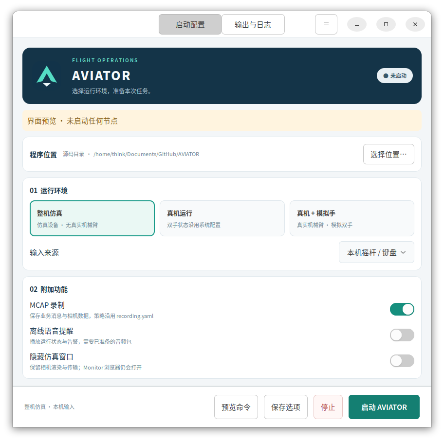

# AVIATOR 桌面启动器

GNOME 托盘菜单和 GTK3 配置窗口。打开工具不会自动启动机器人；选择模式和功能后点击“启动 AVIATOR”。关闭窗口隐藏到托盘，停止按钮通过原脚本有序停止本次节点。



## 启动

源码目录（可从任意工作目录运行）：

```bash
/usr/bin/python3 -B tools/aviator_launcher/main.py --show
/usr/bin/python3 -B tools/aviator_launcher/main.py --check
```

高级选项的“二进制目录”留空时，自动搜索当前源码下的 `build/release/bin`、`build/debug/bin` 和 `build/bin`：

- 按当前模式、录制、语音选项检查所需可执行程序，优先使用完整的 `build/release/bin`。
- Release 不完整时，在其他完整目录中选择所需程序最近修改时间最新的一套（作为编译时间依据）；不跨目录拼接节点。手动指定 Monitor 时，不要求候选目录内存在 Monitor。
- 所有候选都不完整时，仍可预览路径，启动前会报告缺失程序；此时优先展示已有 Release 目录，否则按上述时间选择已有目录。三个目录都不存在时展示 `build/bin`。
- 手动填写的目录始终优先，失效时提示错误。清空该字段可恢复自动选择；“预览命令”可查看实际注入的 `AVIATOR_BIN`。自动路径不保存为固定值，每次预览和启动时重新计算。

首次默认整机仿真；真机选项会启动真实机械臂，模拟手选项只替换手部。`--check` 显示默认整机仿真选项的自动路径，不读取已保存的 UI 选项。直接运行 `start_aviator.sh` 时原有默认目录保持不变。

安装包：

```bash
<安装目录>/bin/aviator_launcher --show
<安装目录>/bin/aviator_launcher --register-desktop
```

工具自动使用同包 `share/aviator/scripts/start_aviator.sh` 和 `bin/`。移动安装包后入口仍可运行，用户应用菜单快捷方式须重新注册。`--unregister-desktop` 移除本工具创建的用户菜单入口；窗口/托盘菜单可选择登录后显示工具，不自动运行节点。

## 依赖

目标环境 Ubuntu 22.04 / GNOME，系统 Python3、PyGObject、GTK3、AppIndicator3 或 AyatanaAppIndicator3。发行版包通常为 `python3-gi`、`gir1.2-gtk-3.0`，以及 `gir1.2-appindicator3-0.1` 或 `gir1.2-ayatanaappindicator3-0.1`。GNOME 还需要启用 AppIndicator / StatusNotifierItem 扩展。缺少托盘宿主时自动保留普通窗口。Wayland/X11 的实际显示仍需目标桌面验收。

请使用系统 Python 运行界面，不要使用 sudo；相机 Python 由高级选项独立指定。脚本已有的 sudo 认证方式保持原样，界面不保存密码。

## 运行与数据

- 配置：`~/.config/aviator-launcher/settings.json`（遵守 XDG_CONFIG_HOME），不同程序来源分别保存。
- 录制默认：`~/.local/share/aviator/recordings`（遵守 XDG_DATA_HOME），通过新环境变量 `AVIATOR_RECORDING_DIR` 传给脚本。未通过工具运行且不设置变量时，脚本仍使用原有 logs 目录。
- 启动器输出：`~/.local/state/aviator-launcher/runs`（遵守 XDG_STATE_HOME）。保留最近 20 轮输出，单轮超过 32 MiB 截断并提示；不删除节点日志和 MCAP。
- 节点日志仍在脚本打印的 `/tmp/aviator-start.*`，可以从界面打开；浏览器不随节点退出自动关闭。
- Runner 使用本用户 XDG_RUNTIME_DIR 的私有 socket；UI 崩溃不自动停止或重启节点。重新打开界面可连接仍存活的 Runner。Runner 自身失联时不根据旧 PID 猜测接管，提示人工检查日志和启动锁。
- 手动处理遗留运行后，可在“输出与日志”点击“重新检查运行状态”：仅当旧脚本身份已消失且启动锁释放时清除状态，不向历史 PID 发信号。
- 停止要等待脚本先停止 Core、手节点和其余节点，可能超过 25 秒；不会用 UI 的短超时强杀脚本。
- 预览执行真正的 `--dry-run`，只预览命令，不证明设备就绪。

## 安装与测试

完整 Linux 构建默认包含工具，`-DAVIATOR_INSTALL_LAUNCHER=OFF` 可关闭。通信子集不安装桌面入口。安装规则在发布清单生成前注册；需要默认 `bin + share` 目录布局，支持任意 prefix。运行不改写包内文件。

```bash
/usr/bin/python3 -B -m unittest discover -s tools/aviator_launcher/tests -v
ctest --test-dir build/release -R '^(launcher|scripts|release_metadata)$' --output-on-failure
```

测试使用临时目录和 fake 节点，不运行真实机器人。详细交互与生命周期设计见 `docs/AVIATOR桌面启动器实现方案.md`。

2026-10-19 验证：16 项启动器回归（含构建目录自动选择）、3 项相关脚本参数/录制目录/清理回归通过；已实际渲染配置和日志页、执行 UI 的 dry-run 预览。完整 CMake 安装与发布校验通过，安装包移动后入口、脚本路径和校验仍通过。全部 scripts 测试中的两个旧标定 UI 用例因本机解释器缺少 pyzmq 未通过；不影响上述专项验证。Wayland、登录自启动及 GNOME 顶栏实际点击仍需目标桌面验收。
